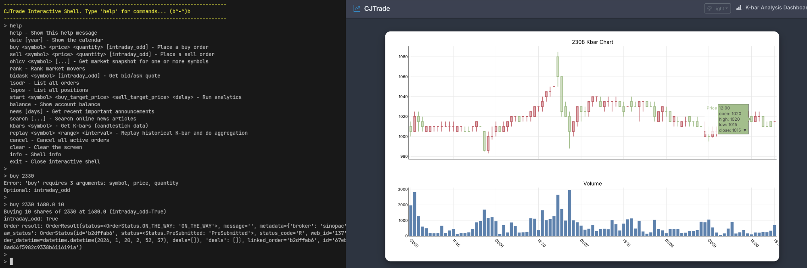
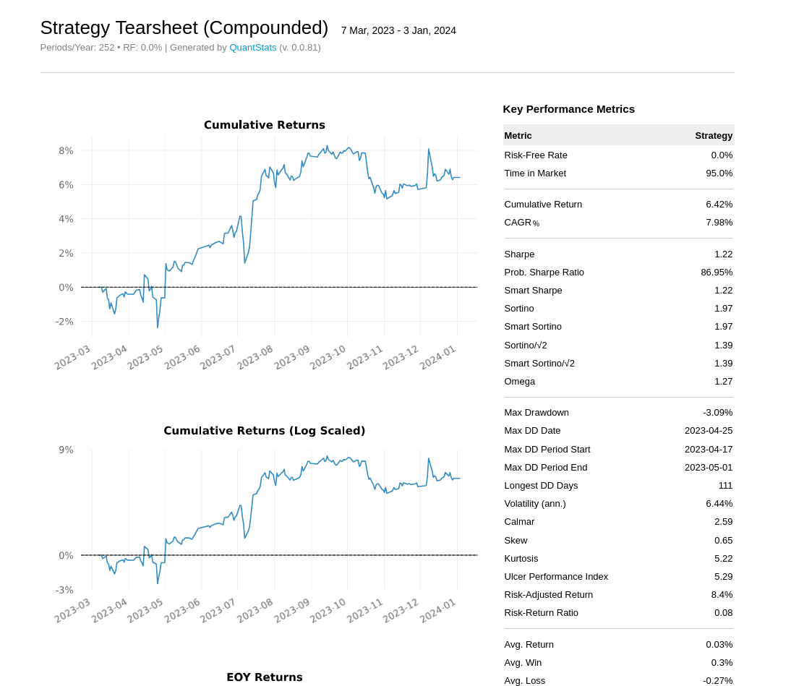

# CJ Trade



**Contents**

1. [Introduction](#1-introduction)
2. [Clone the project and start your quant journey](#2-clone-the-project-and-start-your-quant-journey)
3. [Start developing your trading strategy using the CJTrade API](#3-start-developing-your-trading-strategy-using-the-cjtrade-api)

## 1. Introduction

:warning: This is a Python project, so in theory the SDK and the apps run anywhere Python does. In practice the scripts and apps are written for unix-like systems (Linux / macOS): several of them shell out to `bash`, `curl` and `jq`. Getting them stable on Windows will take some tweaking on your side.

CJ Trade is a framework for building trading systems for `TWSE`.
You write your strategy against the CJTrade API, and the same strategy runs against any supported securities broker (證券商) without being rewritten.

It comes with two main components: `pkgs` and `apps`.

* `pkgs` is the SDK. It provides APIs for:
  * Fetching financial news
  * Calculating technical indicators (技術指標)
  * Talking to securities brokers
  * Asking LLMs for advice
  * Fetching financial statements (財務報表)
  * Drawing K-bars (K線圖)
  * Describing a strategy, and sizing and screening the orders it asks for

* `apps` are example applications built on those `pkgs`.

### Available apps in [`apps`](https://github.com/jackiesogi/CJTrade/tree/master/src/cjtrade/apps)

See [here](./src/cjtrade/apps/README.md)

<details>
<summary><b>Supported Brokers</b></summary>

<ul>
<li>
<b>Sinopac</b> (永豐金證券)<br>
Full implementation with real-time market data and trading support.
</li>

<li>
<b>ArenaX</b> (模擬環境)<br>
Paper trading (模擬交易) and backtesting (回測) environment for strategy testing.
</li>
</ul>

</details>

<details>
<summary><b>Coming Soon</b></summary>

<ul>
<li><b>Cathay</b> (國泰證券)</li>
<li><b>Yuanta</b> (元大證券)</li>
<li><b>Mega</b> (兆豐證券)</li>
<li><b>Interactive Brokers</b> (盈透證券)</li>
</ul>

</details>

## 2. Clone the project and start your quant journey

Install `uv` first — everything here is run through it, so you never activate an
environment by hand:
[https://docs.astral.sh/uv/getting-started/installation/](https://docs.astral.sh/uv/getting-started/installation/)

```sh
git clone https://github.com/jackiesogi/CJTrade
cd CJTrade
uv python install 3.12
uv venv --python 3.12
uv sync
mkdir -p data          # a few of the PoC scripts write their scratch files here
```

`uv run <command>` resolves the environment on its own. Activating it
(`source .venv/bin/activate`) is optional and only useful if you want to call
`python` directly.

Two more things worth knowing before you start:

* `jq` is needed by the shell scripts under `scripts/` and `tests/`
  (`brew install jq` / `apt install jq`).
* Reports, account snapshots and the cached price history are **not** written
  into the checkout. They go to the platform's per-user directories — on macOS
  that is `~/Library/Application Support/cjtrade` for reports and state and
  `~/Library/Caches/cjtrade` for the price database. Every app prints the exact
  list on startup, and `CJTRADE_HOME` moves all of it somewhere else if you
  would rather keep it together.

### Run the CJTrade interactive shell

The CJTrade interactive shell (`cjtrade_shell`) is built for exploring the
CJTrade API by hand: place an order, read a snapshot, pull K-bars, ask an LLM
about your positions. If you are after an automated system instead, skip to
["Run CJTrade System"](#run-cjtrade-system).

#### Play around with the ArenaX broker (built-in simulation environment)

```sh
# generate the simulation environment config template
bash scripts/gen_config.sh arenax

# start the ArenaX simulation backend and remember its pid
uv run arenaxd > /dev/null 2>&1 &
PID=$!

# arenaxd preloads price data before it accepts a session, so give it a moment.
# `curl -s http://127.0.0.1:8801/health` reports `"running": true` when it is ready.
sleep 15

# connect the shell to the ArenaX broker
uv run cjtrade --broker=arenax

# or drive every shell command non-interactively
uv run atest --broker=arenax --group=all   # 'A'renaX 'TEST'

# stop the server when you are done
kill ${PID}
```

Windows users: `scripts/gen_config.bat` generates the same config file.

#### Sinopac users

```sh
# Get your API keys from https://ai.sinotrade.com.tw/python/Main/index.aspx#pag4
bash scripts/gen_config.sh sinopac
```

The generated `sinopac_system.cjconf` leaves the credential fields blank on
purpose. Fill them in with an editor, or append them from the shell:

```sh
cat >> sinopac_system.cjconf <<EOF
# -------- overrides --------
API_KEY = your-api-key
SECRET_KEY = your-secret-key
CA_CERT_PATH = /path/to/Sinopac.pfx
CA_PASSWORD = your-ca-password
EOF

# with that in place, connect to Sinopac
uv run cjtrade --broker=sinopac

# or run the shell test suite against it
uv run test --broker=sinopac
```

:warning: A Sinopac session places real orders. Check the symbol and the
quantity before you confirm a `buy` — the shell does not ask a second time.

### Run CJTrade System

CJTrade System is an automated trading system. It watches your positions and
the price of everything on your watch list, and places orders by itself when a
strategy's condition is met.

:warning: This feature is in the PoC stage and under active development. Expect
rapid changes and potential instability.

:warning: **The ArenaX-driven system (`uv run system`) is on its way out.** It
is kept because paper and real runs still go through it, but for backtesting it
has been superseded by the trading engine in
[`poc/trading_engine/`](./poc/trading_engine/) — see
[Backtesting](#backtesting) below for why.

```sh
# Picking `sinopac` as the broker places REAL orders once a strategy fires,
# unless you export SIMULATION=y before running this.
export CJSYS_WATCH_LIST=0050,2330,2357,2454,3443,3231   # your price watch list
uv run system --broker=arenax --mode=demo
```

### Backtesting

There are three ways to replay history against a strategy. They differ in how
time moves, which is what decides whether two runs of the same configuration
give you the same answer.

| | How it runs | Reproducible | Typical use |
|---|---|---|---|
| `oneshot` | Fetches every bar up front, then walks the series bar by bar | Yes | Parameter sweeps, quick screening |
| **trading engine** | Replays real bar timestamps through a logical clock; strategies run as separate processes against a simulated broker | Yes | The run you report |
| `full_sim` | CJTrade System driven by a sped-up wall clock | No | Watching a system behave end to end |

#### `oneshot`

Gathers all the K-bar data before the backtest starts and matches orders
bar-by-bar (逐根K線分析), usually finishing in seconds.

```sh
bash poc/backtest.sh \
  --watch-list 2317,2357,2454,2890,3443 \
  --fund 5000000 \
  --start 2024-12-16 \
  --days 60 \
  --interval 1d \
  --mode demo
```

`poc/backtest.sh` is a thin wrapper: it fills in a form
(`poc/backtest.toml`), starts `arenaxd` if nothing is listening, and then runs
the backtester. Every form field has a matching flag, and any flag you pass on
the command line is not prompted for — so the call above is non-interactive
while a bare `bash poc/backtest.sh` asks you for everything. `--strategy` picks
the strategy (`BollingerStrategy`, `SupportResistanceStrategy`, `DCA_Monthly`,
`DonchianBreakoutStrategy`, `ADXAdaptiveStrategy`, `BaselineStrategy`), and
`--compare` runs several of them over the same K-bars and overlays their
returns and equity curves in one report.

:memo: A strategy's window parameters are counted in **bars**, not days, so
`--interval` changes what they mean. A 100-bar Bollinger window is 100 minutes
at `1m` and 100 trading days at `1d` — a different strategy, not a coarser one.
To see the values an interval will actually use:

```sh
uv run python -m cjtrade.apps.cjtrade_system.cjtrade_oneshot_backtest \
  --interval 1m --show-params
```

#### Trading engine

The engine lives in [`poc/trading_engine/`](./poc/trading_engine/) and is the
deterministic replacement for `full_sim`. Each strategy runs in its own
process, talks to a master process over ZeroMQ, and only the master holds a
broker session — so no strategy can place an order behind the risk gate's back.

What makes it reproducible is the clock. `full_sim` samples prices on a
*wall-clock* timer while the ArenaX server advances its own virtual clock at the
playback speed you asked for, so how many bars a strategy sees, and which
prices land in the same bar, depends on how busy the machine was. The engine
instead builds the list of real bar timestamps from the price data before the
run starts, and logical time is just a cursor into that list: one step per bar,
and every step pushes the server's market time to match. The sequence of bars
is therefore a property of the data, not of the machine, and `--speed=0` (flat
out, no pacing at all) produces exactly the same bars as `--speed=60`.

```sh
# the engine expects the backtest backend, which listens on 8802
unset AX_HOST_PORT AX_HOST_ADDRESS AX_LAUNCH_MODE AX_STATE_FILE
uv run arenaxd --backend=backtest > /dev/null 2>&1 &
sleep 15

ARENAX_PORT=8802 uv run python poc/trading_engine/main2.py \
  --broker=arenax --mode=backtest \
  --watch-list=0050,2317 \
  --fund=1000000 --days=30 --start-date=2025-09-01 \
  --speed=0
```

As with `poc/backtest.sh`, the flags come from a form
(`poc/backtest_full_simulation.toml`) and anything you leave out is prompted
for. While a run is in progress it serves a read-only status page on
`http://127.0.0.1:8898/status` (loopback only) with per-bot progress, equity and
what the risk gate has refused.

#### `full_sim`

This is CJTrade System itself, replaying historical prices at high speed (up to
30,000x) with live monitoring and analysis on top. It is by far the most
interesting one to watch. It is also the one whose numbers you should not quote:
at high playback speed the timing of each sample drifts, so the bars depend on
how busy the machine was and two identical runs need not agree. Use the engine
or `oneshot` for anything you intend to compare.

```sh
bash poc/backtest_full_simulation.sh
```

#### Reading the result

The engine and `oneshot` both leave a result file behind along with an HTML
tearsheet (CAGR, Sharpe ratio, win rate, drawdowns...). `insight` reads that
file and writes a report you can actually diagnose a run from. The difference
matters: a result file only records what the strategy did, so `insight` reads
the 1-minute price history on disk for the same window and puts the two side by
side. That is what lets it answer whether the market suited the strategy, rather
than only how the strategy ended up.

```sh
uv run insight            # the most recent run
uv run insight --list     # every run on this machine
uv run insight 51702f96   # by session id, or any unique prefix
```



### Test

1. Shell-level smoke tests — runs every command in the CJTrade shell:

```sh
uv run atest --broker=arenax --group=all
# groups: trading | query | market | system | all
```

2. Broker hot paths — normal input, edge cases and stress:

```sh
bash tests/run_broker_stability_tests.sh --broker=arenax
```

3. Unit tests:

```sh
uv run pytest tests/unit
```

## 3. Start developing your trading strategy using the CJTrade API

:warning: The API is not stable yet.

See the [API reference](https://github.com/jackiesogi/CJTrade/tree/master/doc).

The shortest path to a strategy of your own is
`cjtrade.pkgs.strategy.authoring`: a single module holding the entire
vocabulary a strategy file may use (`on_bar`, `buy`, `sell`, `hold`, `ta.*`,
`param.*`). A file written against it runs under the trading engine without
being registered anywhere. `uv run strategy-tool templates` lists the starting
points, and `uv run strategy-tool check < my_strategy.py` tells you what is
wrong with yours before a run does.
