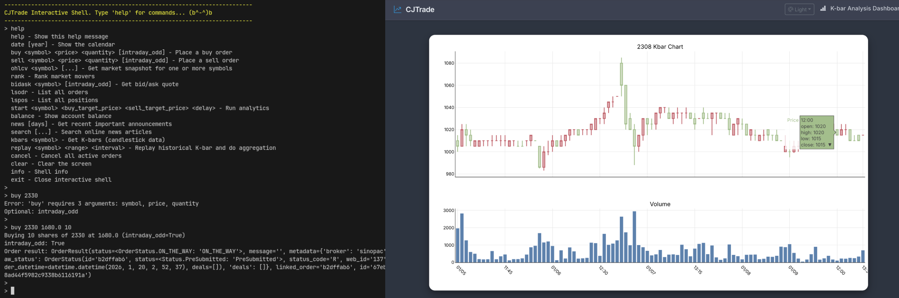

# CJTrade

[](https://github.com/jackiesogi/CJTrade/actions/workflows/ci.yml)
[](https://jackiesogi.github.io/CJTrade/)
[](./LICENSE)

A Python framework for building trading systems for the Taiwan Stock Exchange
(TWSE). Write a strategy once against the CJTrade API, then run it against a
simulated broker, a historical replay, or a real brokerage account without
changing it.

**Documentation:** <https://jackiesogi.github.io/CJTrade/>
([繁體中文](https://jackiesogi.github.io/CJTrade/zh-TW/))



## Features

- **One broker API.** `AccountClient` covers accounts, orders, quotes and
  historical bars, the same way for every broker.
- **ArenaX, a built-in simulated broker.** A local server for demos, paper
  trading and backtests, with TWSE commission and tax applied to every fill.
- **Reproducible backtesting.** A fast in-memory backtester, and a trading
  engine that replays real bar timestamps so two runs give the same orders.
- **Strategy authoring.** A strategy is one file using a small vocabulary
  (`on_bar`, `buy`, `sell`, `ta.*`, `param.*`), checked before it runs.
- **Risk controls.** Per-strategy capital limits, order-rate limits,
  duplicate-order detection and a loss kill switch.
- **Analytics.** Technical indicators (TA-Lib), TWSE fundamentals, news,
  LLM clients, quantstats reports and run diagnostics.

| Broker | Status |
|---|---|
| **ArenaX** (simulated) | `demo`, `backtest`, `paper` backends |
| **Sinopac** 永豐金證券 | Live trading and market data through `shioaji` |
| Cathay, Yuanta, Mega, Interactive Brokers | Planned |

## Installation

Requires Python 3.12+ and [uv](https://docs.astral.sh/uv/getting-started/installation/).
The apps and scripts target Linux and macOS, and the shell scripts need `jq`.

<!-- cjcheck: static -->
```sh
git clone https://github.com/jackiesogi/CJTrade
cd CJTrade
uv sync
```

`uv sync` installs everything, including the optional integrations. To use
CJTrade as a library instead, install the core and the extras you need:

<!-- cjcheck: skip reason="installs from GitHub into the current environment" -->
```sh
pip install 'cjtrade[sinopac,llm] @ git+https://github.com/jackiesogi/CJTrade'
```

| Extra | Adds |
|---|---|
| `sinopac` | The Sinopac broker (`shioaji`), also needed by ArenaX's `backtest` and `paper` backends |
| `llm` | Gemini and Azure OpenAI clients |
| `news` | The NewsAPI news source |
| `all` | All of the above |

Reports, account snapshots and the price cache are written to per-user
platform directories, not the checkout. Set `CJTRADE_HOME` to keep them in
one place.

## Quick start

Start the simulated broker and leave it running:

<!-- cjcheck: static -->
```sh
uv run arenaxd
```

Then connect to it from Python:

<!-- cjcheck: static -->
```python
from cjtrade.pkgs.brokers.account_client import AccountClient, BrokerType
from cjtrade.pkgs.models.product import Product

client = AccountClient(BrokerType.ARENAX, api_key="testkey123")
client.connect()

print(client.get_balance())
print(client.get_snapshots([Product("2330")])[0].close)
result = client.buy_stock("2330", 1, 1000.0)    # 1 share, limit 1000
print(result.status)

client.disconnect()
```

Or explore the same API interactively with the shell:

<!-- cjcheck: static -->
```sh
bash scripts/gen_config.sh arenax   # writes arenax_system.cjconf
uv run cjshell --broker=arenax
```

The [Get started guide](https://jackiesogi.github.io/CJTrade/get-started/connect/)
walks through accounts, orders, market data, strategies and backtests.

### Sinopac

Generate a config file, fill in the credentials from
[Sinopac's API portal](https://ai.sinotrade.com.tw/python/Main/index.aspx#pag4),
and connect:

<!-- cjcheck: static -->
```sh
bash scripts/gen_config.sh sinopac  # then edit sinopac_system.cjconf
uv run cjshell --broker=sinopac
```

> [!CAUTION]
> A Sinopac session places **real orders**, and the shell does not ask for
> confirmation. Set `SIMULATION = y` in the config file to use Sinopac's
> sandbox.

## Backtesting

| Method | How time moves | Reproducible | Use it for |
|---|---|---|---|
| `oneshot` | Walks a pre-fetched bar series | Yes | Parameter sweeps, quick screening |
| Trading engine (`cjtrade`) | Steps through real bar timestamps | Yes | Results you intend to compare |

Strategy windows are counted in **bars**, so changing `--interval` changes
the strategy: a 100-bar window is 100 minutes at `1m` and 100 days at `1d`.

### `oneshot`

<!-- cjcheck: static -->
```sh
bash poc/backtest.sh --renderer=cli \
  --watch-list 2317,2357 --fund 1000000 \
  --start 2024-12-16 --days 60 --interval 1d \
  --strategy BollingerStrategy --mode demo
```

The script starts `arenaxd` if needed and asks for anything not given on the
command line. Built-in strategies: `BollingerStrategy`, `ADXAdaptiveStrategy`,
`DCA_Monthly`, `DonchianBreakoutStrategy`, `SupportResistanceStrategy`,
`BaselineStrategy`.

### Trading engine

`cjtrade` is the trading app. Each strategy runs as its own process; only the master process holds the
broker session and the risk gate. Every bar, the master publishes each
symbol's closed 1m bars (`client.market.get_kbars`) to its bots. Before
stepping to the next bar, it waits for every bot to answer the current one,
so `--speed=0` and `--speed=60` produce the same bars, orders and fills.

<!-- cjcheck: static -->
```sh
uv run arenaxd --backend=backtest --port=8802 > /dev/null 2>&1 &
sleep 15
uv run cjtrade --broker=arenax \
  --mode=backtest --watch-list=2357 \
  --fund=1000000 --days=30 --start-date=2025-09-01 --speed=0
```

The bots that run are listed in `BOT_ROSTER` in
[`src/cjtrade/apps/CJTrade/main.py`](./src/cjtrade/apps/CJTrade/main.py), or in a file
passed with `--roster=`. A read-only status page is served on
`http://127.0.0.1:8898/status` while a run is in progress.

> [!NOTE]
> By default the `backtest` backend reads prices from Sinopac, so it needs
> the `sinopac` extra and credentials; `arenaxd --data=finmind,yfinance`
> runs it without a broker account, and `--data=offline --price-db=FILE`
> runs it on bars preloaded with `preload-prices`, with no network at all.

### Reading the result

Each run leaves a result file and an HTML tearsheet. `insight` joins the
result with the price history for the same window and writes a diagnostic
report:

<!-- cjcheck: static -->
```sh
uv run insight            # the most recent run
uv run insight --list     # every run on this machine
```

## Writing a strategy

<!-- cjcheck: static -->
```sh
uv run strategy-tool templates                      # available templates
uv run strategy-tool template --kind bb             # a complete starter file (JSON)
uv run strategy-tool check < my_strategy.py         # diagnostics before you run it
```

See [Write a strategy](https://jackiesogi.github.io/CJTrade/get-started/strategy/)
for the full vocabulary.

## Development

<!-- cjcheck: static -->
```sh
uv run pytest                                       # unit + integration
uv run python scripts/check_readme_examples.py      # README commands still work
uv run --group docs mkdocs serve                    # docs at http://127.0.0.1:8000
```

The same checks run as pre-commit hooks and in CI. Developer notes, design
records and the to-do list are in [`ref/`](./ref/).

## License

[MIT](./LICENSE).

CJTrade is not investment advice, and nothing it prints is a recommendation to
buy or sell. It can place real orders on a real account; you are responsible
for every order it sends and for any loss that follows. Test a strategy on
ArenaX, then on Sinopac's sandbox, before trading real money.
