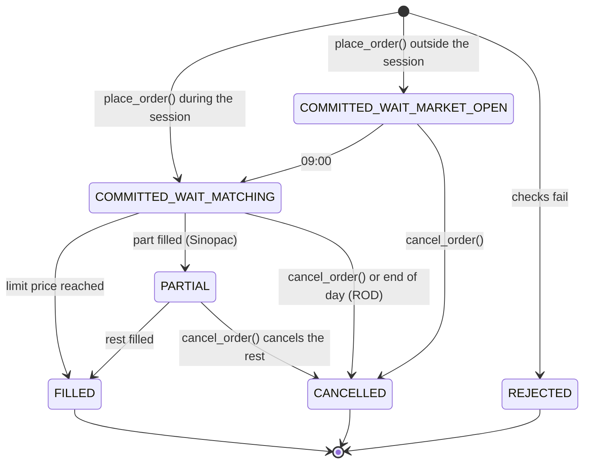

# Account and orders

This page buys one share on ArenaX, checks the fill and the resulting
position, then places and cancels an order that does not fill.

ArenaX must be running, as started in [Connect to a broker](connect.md).
Each example is a complete script; run it with `uv run python file.py`.

## Order lifecycle



| Status | Meaning |
|---|---|
| `COMMITTED_WAIT_MATCHING` | accepted by the broker, waiting for the price |
| `COMMITTED_WAIT_MARKET_OPEN` | accepted outside trading hours; waits for 09:00 |
| `FILLED` | filled; cash and positions updated |
| `PARTIAL` | part of the quantity filled; only real brokers report it, ArenaX fills every order in full |
| `CANCELLED` | cancelled by you, or expired at the end of the day |
| `REJECTED` | refused by the broker; `result.message` gives the reason |

!!! warning "Problems come back as a status, not an error"
    Order methods do not raise when an order is refused. Always check
    `result.status`.

## Buy one share {#buy-one-share}

The example bids 2% above the last price so that the order fills:

```python
import time
from cjtrade.pkgs.brokers.account_client import AccountClient, BrokerType
from cjtrade.pkgs.models.product import Product

client = AccountClient(BrokerType.ARENAX, api_key="testkey123")
client.connect()

snap = client.get_snapshots([Product("2330")])[0]
print("last price:", snap.close)

price = round(snap.close * 1.02, 1)
result = client.buy_stock("2330", 1, price)     # symbol, shares, limit price
print("order:", result.status.value, result.linked_order)

time.sleep(3)                                    # let ArenaX match it
for t in client.list_orders():
    print("listed:", t.symbol, t.action, t.quantity, t.price, t.status)
print("positions:", client.get_positions())
print("balance:", client.get_balance())

client.disconnect()
```

- `get_snapshots(...)[0].close` is the last traded price.
- `buy_stock(symbol, quantity, price)` places a limit buy in **odd lots**:
  `1` is one share.
- `result.linked_order` is the order id, required by `cancel_order`.
- `list_orders()` returns this account's orders with their current status.

Expected output (your prices will differ):

```text
last price: 2370.0
order: COMMITTED_WAIT_MATCHING 1eed911f91df431f8cdfee65fad7722c
listed: 2330 BUY 1 2417.4 FILLED
positions: [Position(symbol='2330', quantity=1, avg_cost=2417.4, current_price=2375.0, market_value=2375.0, unrealized_pnl=-42.4)]
balance: 97562.6
```

- `buy_stock` returns `COMMITTED_WAIT_MATCHING`; ArenaX matches the order
  against the next minute's prices within a few seconds, after which
  `list_orders()` shows `FILLED`.
- `unrealized_pnl` is marked at `current_price`.
- The balance falls by the fill price plus the NT$20 minimum commission:
  100,000 − 2,417.4 − 20 = 97,562.6.

!!! warning "ArenaX fills at your limit price"
    ArenaX books a fill at the order's price, not at the market price: the
    order above paid 2,417.4 for a share trading at 2,370, where a real
    broker would fill at the better market price. Bid close to the market
    to keep simulated costs realistic.

## Place a resting order, then cancel it

A buy 20% below the market stays open until cancelled:

```python
from cjtrade.pkgs.brokers.account_client import AccountClient, BrokerType
from cjtrade.pkgs.models.product import Product

client = AccountClient(BrokerType.ARENAX, api_key="testkey123")
client.connect()

snap = client.get_snapshots([Product("2330")])[0]
result = client.buy_stock("2330", 1, round(snap.close * 0.8, 1))
print("placed:", result.status.value)

cancel = client.cancel_order(result.linked_order)
print("cancel:", cancel.status.value, "-", cancel.message)

client.disconnect()
```

Expected output:

```text
placed: COMMITTED_WAIT_MATCHING
cancel: CANCELLED - Order cancelled successfully.
```

Cancelling an order that has already filled returns `REJECTED`, with the
reason in `message`.

## Sell

`sell_stock` takes the same arguments as `buy_stock`. To sell the share
bought above, priced to fill at the market:

```python
result = client.sell_stock("2330", 1, round(snap.close * 0.98, 1))
```

Selling more shares than you hold is `REJECTED`.

## Build an `Order` explicitly

`buy_stock` and `sell_stock` fill in defaults. To set every field:

```python
from cjtrade.pkgs.models.order import Order, OrderAction, OrderLot, OrderType, PriceType
from cjtrade.pkgs.models.product import Product

order = Order(
    product=Product("2330"),
    action=OrderAction.BUY,
    price=1000.0,
    quantity=1,
    price_type=PriceType.LMT,           # a limit order
    order_type=OrderType.ROD,           # good for the rest of the day
    order_lot=OrderLot.IntraDayOdd,     # quantity in shares
)
result = client.place_order(order)
```

!!! warning "What `quantity` counts depends on `order_lot`"
    `OrderLot.IntraDayOdd` counts **shares**. `OrderLot.Common` counts
    **lots of 1,000 shares**. On a real account, `quantity=1` is either one
    share or a thousand.

## Cheat sheet

| Call | Returns |
|---|---|
| `client.get_balance()` | cash in NT$ (`float`) |
| `client.get_positions()` | list of `Position(symbol, quantity, avg_cost, current_price, market_value, unrealized_pnl)` |
| `client.buy_stock(symbol, qty, price)` / `sell_stock(...)` | `OrderResult(status, message, linked_order, ...)` |
| `client.place_order(order)` | `OrderResult` |
| `client.cancel_order(order_id)` | `OrderResult` |
| `client.list_orders()` | list of `Trade(id, symbol, action, quantity, price, status, ...)` |
| `client.sync_state()` | refreshes the status of open orders from the broker |

Every method is listed in the [AccountClient reference](../reference/account-client.md).

Next: [Market data](market-data.md).
