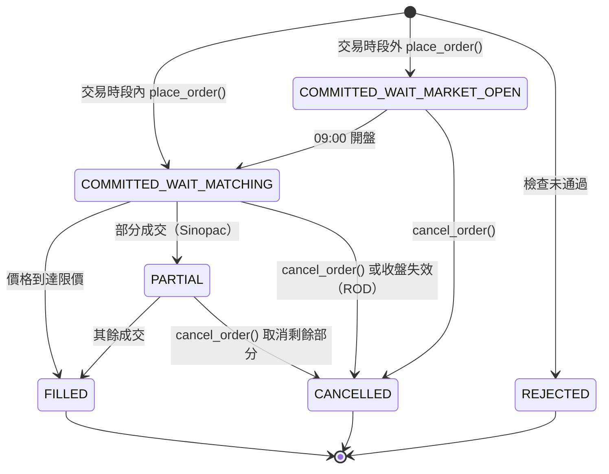

# 帳戶與委託

本頁在 ArenaX 上買進一股，確認成交與持股，接著下一筆不會成交的委託並將其取消。

ArenaX 須保持執行（啟動方式見[連線到券商](connect.md)）。每個範例都是完整的程式，以 `uv run python file.py` 執行。

## 委託生命週期



| 狀態 | 意思 |
|---|---|
| `COMMITTED_WAIT_MATCHING` | 券商已接受，等待價格到達 |
| `COMMITTED_WAIT_MARKET_OPEN` | 於交易時段外接受，等待 09:00 開盤 |
| `FILLED` | 已成交，現金和持股已更新 |
| `PARTIAL` | 部分數量已成交；只有正式券商會回報，ArenaX 一律全部成交 |
| `CANCELLED` | 已由你取消，或於收盤時失效 |
| `REJECTED` | 券商拒絕，原因見 `result.message` |

!!! warning "問題以狀態回報，不會拋出錯誤"
    委託被拒絕時，下單方法不會拋出例外。務必檢查 `result.status`。

## 買一股 {#buy-one-share}

範例以高於最新成交價 2% 的價格出價，確保成交：

```python
import time
from cjtrade.pkgs.brokers.account_client import AccountClient, BrokerType
from cjtrade.pkgs.models.product import Product

client = AccountClient(BrokerType.ARENAX, api_key="testkey123")
client.connect()

snap = client.get_snapshots([Product("2330")])[0]
print("last price:", snap.close)

price = round(snap.close * 1.02, 1)
result = client.buy_stock("2330", 1, price)     # 股票代號、股數、限價
print("order:", result.status.value, result.linked_order)

time.sleep(3)                                    # 讓 ArenaX 撮合
for t in client.list_orders():
    print("listed:", t.symbol, t.action, t.quantity, t.price, t.status)
print("positions:", client.get_positions())
print("balance:", client.get_balance())

client.disconnect()
```

- `get_snapshots(...)[0].close` 是最新成交價。
- `buy_stock(symbol, quantity, price)` 下一筆**零股**限價買進委託：`1` 即一股。
- `result.linked_order` 是委託 id，`cancel_order` 需要用到。
- `list_orders()` 回傳此帳戶的委託及其目前狀態。

預期輸出（價格會不同）：

```text
last price: 2370.0
order: COMMITTED_WAIT_MATCHING 1eed911f91df431f8cdfee65fad7722c
listed: 2330 BUY 1 2417.4 FILLED
positions: [Position(symbol='2330', quantity=1, avg_cost=2417.4, current_price=2375.0, market_value=2375.0, unrealized_pnl=-42.4)]
balance: 97562.6
```

- `buy_stock` 回傳 `COMMITTED_WAIT_MATCHING`；ArenaX 在數秒內以下一分鐘的價格撮合，之後 `list_orders()` 顯示 `FILLED`。
- `unrealized_pnl` 以 `current_price` 計算。
- 餘額減少的金額為成交價加上最低手續費 NT$20：100,000 − 2,417.4 − 20 = 97,562.6。

!!! warning "ArenaX 以你的限價成交"
    ArenaX 以委託價格而非市價記錄成交：上例中，市價 2,370 的股票以 2,417.4 成交，正式券商則會以較佳的市價成交。出價請貼近市價，模擬成本才會接近實際。

## 掛單後取消

低於市價 20% 的買進委託會持續掛著，直到取消：

```python
from cjtrade.pkgs.brokers.account_client import AccountClient, BrokerType
from cjtrade.pkgs.models.product import Product

client = AccountClient(BrokerType.ARENAX, api_key="testkey123")
client.connect()

snap = client.get_snapshots([Product("2330")])[0]
result = client.buy_stock("2330", 1, round(snap.close * 0.8, 1))
print("placed:", result.status.value)

cancel = client.cancel_order(result.linked_order)
print("cancel:", cancel.status.value, "-", cancel.message)

client.disconnect()
```

預期輸出：

```text
placed: COMMITTED_WAIT_MATCHING
cancel: CANCELLED - Order cancelled successfully.
```

取消已成交的委託會回傳 `REJECTED`，原因見 `message`。

## 賣出

`sell_stock` 的參數與 `buy_stock` 相同。以可在市價成交的價格賣出上面買進的一股：

```python
result = client.sell_stock("2330", 1, round(snap.close * 0.98, 1))
```

賣出股數超過持股時會被 `REJECTED`。

## 自行建立 `Order`

`buy_stock` 和 `sell_stock` 會套用預設值。若要指定每個欄位：

```python
from cjtrade.pkgs.models.order import Order, OrderAction, OrderLot, OrderType, PriceType
from cjtrade.pkgs.models.product import Product

order = Order(
    product=Product("2330"),
    action=OrderAction.BUY,
    price=1000.0,
    quantity=1,
    price_type=PriceType.LMT,           # 限價委託
    order_type=OrderType.ROD,           # 當日有效
    order_lot=OrderLot.IntraDayOdd,     # 數量以股為單位
)
result = client.place_order(order)
```

!!! warning "`quantity` 的單位取決於 `order_lot`"
    `OrderLot.IntraDayOdd` 以**股**計算，`OrderLot.Common` 以**張（1,000 股）**計算。在正式帳戶上，`quantity=1` 可能是一股，也可能是一千股。

## 常用呼叫一覽

| 呼叫 | 回傳 |
|---|---|
| `client.get_balance()` | 新台幣現金（`float`） |
| `client.get_positions()` | `Position(symbol, quantity, avg_cost, current_price, market_value, unrealized_pnl)` 的清單 |
| `client.buy_stock(symbol, qty, price)` / `sell_stock(...)` | `OrderResult(status, message, linked_order, ...)` |
| `client.place_order(order)` | `OrderResult` |
| `client.cancel_order(order_id)` | `OrderResult` |
| `client.list_orders()` | `Trade(id, symbol, action, quantity, price, status, ...)` 的清單 |
| `client.sync_state()` | 從券商更新未成交委託的狀態 |

完整方法列表見 [AccountClient 參考](../reference/account-client.md)。

下一步：[行情資料](market-data.md)。
