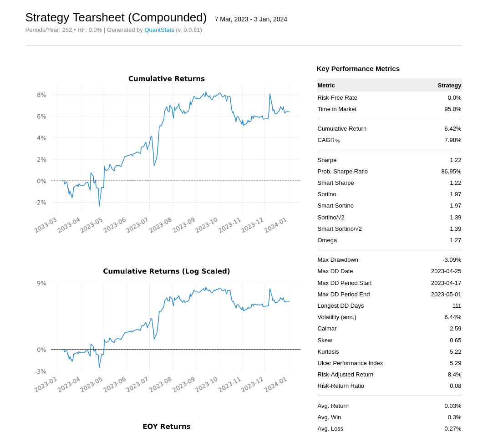

# Backtesting

In this page you run a strategy over a year of real TSMC (2330) prices and
read the result. It runs entirely in memory, needs no server, and finishes
in a few seconds.

A *backtest* answers "what would this strategy have done?". Keep in mind
that a good backtest is not a promise: the past does not repeat exactly, and
a simulation is always a little kinder than a real market (see
[What a backtest leaves out](#what-a-backtest-leaves-out)).

## Run a built-in strategy

CJTrade comes with ready-made strategies. This runs the Bollinger band
strategy over 2024 with NT$1,000,000:

```python
from cjtrade.pkgs.marketdata import Cached, Fallback, FinMindMarketData, YFinanceMarketData
from cjtrade.pkgs.analytics.backtest.engine import BacktestEngine
from cjtrade.pkgs.analytics.evaluation.quantstats import BacktestReport
from cjtrade.pkgs.strategy.bb import BollingerStrategy

# 1. Get a year of daily bars from the free sources.
market = Cached(Fallback([FinMindMarketData(), YFinanceMarketData()]))
kbars = market.get_kbars("2330", "2024-01-01", "2025-01-01", "1d")
print("bars:", len(kbars))

# 2. Run the strategy over them.
engine = BacktestEngine(kbars=kbars, symbol="2330", initial_balance=1_000_000,
                        params={"bb__window_size": 20})
result = engine.run(BollingerStrategy())

# 3. Print the summary and every trade.
report = BacktestReport(result)
report.summary()
report.print_round_trips()
```

- Step 1 is the same as in [Market data](market-data.md).
- `params={"bb__window_size": 20}` sets the strategy's parameters. Built-in
  strategies name them `<group>__<name>`; [Built-in strategies](../reference/strategies.md)
  lists them all.
- `engine.run(...)` walks through the bars one at a time, asks the strategy
  what to do, and simulates each order.

Expected output:

```text
bars: 242
==================================================
  Backtest Summary
==================================================
  Session      : N/A
  Start time   : 2024-01-02T09:00:00
  Init balance :    1,000,000.00
  Final balance:    1,016,806.00
  Final equity :    1,016,806.00
  PnL (Total)  :      +16,806.00  (+1.68%)
  rPnL         :      +16,806.00
  uPnL         :           +0.00  (+0.00%)
  Total fills  : 4
  Commission   :          307.65
  Tax (證交稅)  :          350.03
  Total cost   :          657.68
  Equity pts   : 242
  Sharpe ratio : 2.0471  (daily resolution, annualised)
  CAGR         : 1.76%
  Max drawdown : -0.50%
  Round trips  : 2  (win 2 / loss 0,  win rate 100.0%)
  Avg PnL/trip : +8,732.00
  Avg hold days: 38.5
==================================================
================================================================================
  Round-Trip History  (2 trades,  win 2 / loss 0,  total PnL +17,464.00)
================================================================================
    #  Symbol    Entry Date      Entry $  Exit Date        Exit $     Qty         PnL   Days
  ----------------------------------------------------------------------------
    1  2330      2024-04-19       750.00  2024-05-15       839.00      66    +5874.00    26d  🟢
    2  2330      2024-08-05       815.00  2024-09-25      1005.00      61   +11590.00    51d  🟢
================================================================================
```

The same bars always give the same result, so you should see exactly these
numbers.

## Read the summary {#read-the-summary}

| Line | Meaning |
|---|---|
| Init balance / Final balance | cash at the start and at the end |
| Final equity | cash plus the value of the shares still held |
| PnL (Total) | profit or loss: final equity minus initial balance |
| rPnL / uPnL | *realised* (from closed trades) and *unrealised* (shares still held) profit |
| Total fills | how many orders filled; a round trip is two fills |
| Commission, Tax, Total cost | what the fills paid in fees |
| Sharpe ratio | return relative to how much the account value swung; above 1 is usually considered good |
| CAGR | the yearly growth rate the result corresponds to |
| Max drawdown | the largest fall from a peak, in percent |
| Round trips, win rate | buy-then-sell pairs, and how many made money |

In this run the strategy traded twice and won both times, for +1.68% after
costs. It bought only 66 and 61 shares: by default a built-in strategy puts
about 5% of the account into one position, so most of the money stayed in
cash. That is why the profit is small next to the stock's own rise that
year.

## Run your own strategy file

The file from [Write a strategy](strategy.md) runs the same way once loaded:

```python
from pathlib import Path
from cjtrade.pkgs.strategy.user_strategy import load

strategy = load(Path("my_strategy.py").read_text())
result = BacktestEngine(kbars=kbars, symbol="2330",
                        initial_balance=1_000_000).run(strategy)

for f in result.fill_history:
    print(f["time"][:10], f["action"], f["quantity"], f["price"], f["reason"])
```

Expected output:

```text
2024-04-19 BUY 66 750.0 lower band touch
2024-05-15 SELL 66 839.0 upper band touch
2024-08-05 BUY 61 815.0 lower band touch
2024-09-25 SELL 61 1005.0 upper band touch
```

These are the same trades as the built-in strategy, since `my_strategy.py`
follows the same rules. The `reason` is the text you passed to `buy()` and
`sell()`.

## Save a full report

```python
report.save_html("report.html")
print(report.metrics()["pnl_pct"])          # every number as a dict
```

`report.html` is a full performance report (a *tearsheet*) with charts of
the account value, drawdowns and monthly returns. Open it in a browser:



`report.full_report()` writes the same file and opens it for you; pass
`open_browser=False` on a machine without a browser.

## Costs

Every fill pays the TWSE costs: a commission of 0.1425% of its value with a
NT$20 minimum, and on sells a transaction tax of 0.3% (0.1% for ETFs, the
symbols starting with `0`). To model a broker discount or slippage, pass a
`CostModel`:

```python
from cjtrade.pkgs.models.cost import CostModel

engine = BacktestEngine(kbars=kbars, symbol="2330", initial_balance=1_000_000,
                        cost_model=CostModel(commission_discount=0.6))   # 六折
```

See [Cost model](../reference/cost-model.md) for every option.

## What a backtest leaves out {#what-a-backtest-leaves-out}

The oneshot backtester is fast because it simplifies:

- A signal calculated on a bar's close is filled **on that bar, at that
  price**, even if a real market would not have given you that price.
- There is no limit on volume: any size fills at once.
- TWSE's daily price limits (漲跌停) are not applied.

Treat the result as the best case. For a closer simulation, minute by
minute with real order matching, use the
[trading engine](trading-engine.md); its numbers are usually lower, so
compare trends rather than exact amounts between the two.

Next: [Run the trading engine](trading-engine.md).
