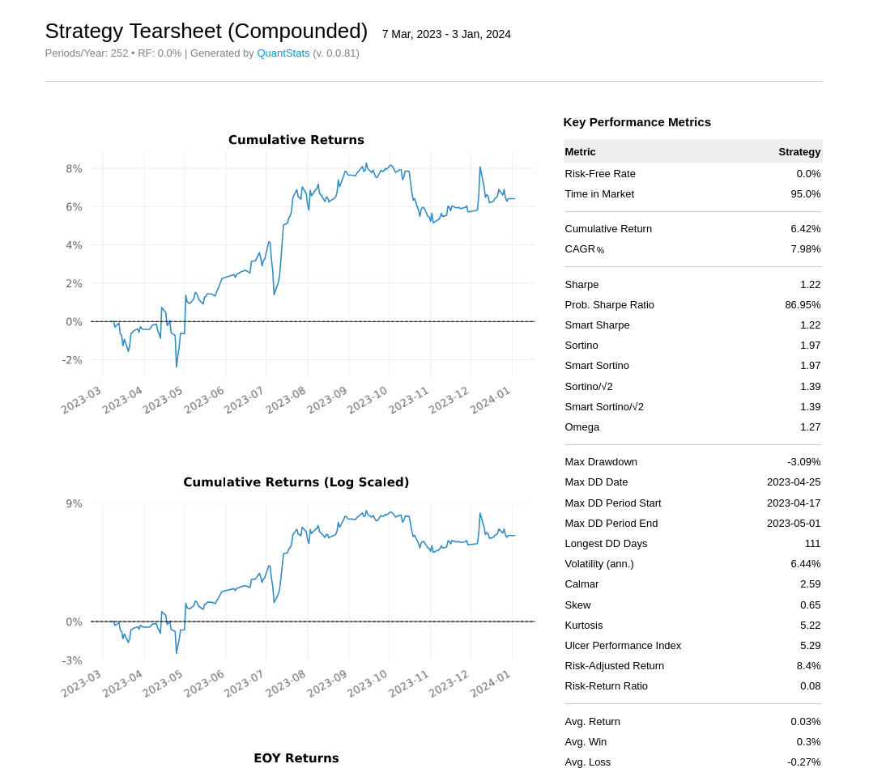

# 回測

以台積電（2330）一年的日 K 對策略做一次性回測。全程在記憶體中執行，不需要伺服器，數秒內完成。它的成交模型偏樂觀，見[回測沒有考慮到的事](#what-a-backtest-leaves-out)。

## 執行內建策略

以 NT$1,000,000 對 2024 年執行內建的布林通道策略：

```python
from cjtrade.pkgs.marketdata import Cached, Fallback, FinMindMarketData, YFinanceMarketData
from cjtrade.pkgs.analytics.backtest.engine import BacktestEngine
from cjtrade.pkgs.analytics.evaluation.quantstats import BacktestReport
from cjtrade.pkgs.strategy.bb import BollingerStrategy

# 1. 從免費來源取得一年的日 K。
market = Cached(Fallback([FinMindMarketData(), YFinanceMarketData()]))
kbars = market.get_kbars("2330", "2024-01-01", "2025-01-01", "1d")
print("bars:", len(kbars))

# 2. 用這些 K 棒執行策略。
engine = BacktestEngine(kbars=kbars, symbol="2330", initial_balance=1_000_000,
                        params={"bb__window_size": 20})
result = engine.run(BollingerStrategy())

# 3. 印出摘要和每一筆交易。
report = BacktestReport(result)
report.summary()
report.print_round_trips()
```

- 第 1 步和[行情資料](market-data.md)裡的做法一樣。
- `params={"bb__window_size": 20}` 設定策略參數。內建策略的參數鍵格式為 `<group>__<name>`；完整清單見[內建策略](../reference/strategies.md)。
- `engine.run(...)` 逐根走過 K 棒，對每根呼叫策略，並模擬產生的委託。

預期輸出：

```text
bars: 242
==================================================
  Backtest Summary
==================================================
  Session      : N/A
  Start time   : 2024-01-02T09:00:00
  Init balance :    1,000,000.00
  Final balance:    1,016,806.00
  Final equity :    1,016,806.00
  PnL (Total)  :      +16,806.00  (+1.68%)
  rPnL         :      +16,806.00
  uPnL         :           +0.00  (+0.00%)
  Total fills  : 4
  Commission   :          307.65
  Tax (證交稅)  :          350.03
  Total cost   :          657.68
  Equity pts   : 242
  Sharpe ratio : 2.0471  (daily resolution, annualised)
  CAGR         : 1.76%
  Max drawdown : -0.50%
  Round trips  : 2  (win 2 / loss 0,  win rate 100.0%)
  Avg PnL/trip : +8,732.00
  Avg hold days: 38.5
==================================================
================================================================================
  Round-Trip History  (2 trades,  win 2 / loss 0,  total PnL +17,464.00)
================================================================================
    #  Symbol    Entry Date      Entry $  Exit Date        Exit $     Qty         PnL   Days
  ----------------------------------------------------------------------------
    1  2330      2024-04-19       750.00  2024-05-15       839.00      66    +5874.00    26d  🟢
    2  2330      2024-08-05       815.00  2024-09-25      1005.00      61   +11590.00    51d  🟢
================================================================================
```

回測結果是確定性的：同樣的 K 棒會得到與上面完全相同的數字。

## 看懂摘要 {#read-the-summary}

| 欄位 | 意思 |
|---|---|
| Init balance / Final balance | 期初與期末現金 |
| Final equity | 現金 + 未平倉持股的市值 |
| PnL (Total) | 期末權益 − 期初餘額，金額與百分比 |
| rPnL / uPnL | 已實現損益（已平倉交易造成的現金變動）／未實現損益（未平倉部位） |
| Total fills | 成交筆數；一次 round trip 算兩筆 |
| Commission, Tax, Total cost | 所有成交的費用加總 |
| Sharpe ratio | 以權益曲線報酬計算，日解析度，年化 |
| CAGR | 以同一組報酬年化 |
| Max drawdown | 權益曲線從高點到低點的最大回撤，% |
| Round trips, win rate | 先買後賣的配對數，以及損益為正的比例 |

這次執行有兩次 round trip，都獲利，扣除成本後 +1.68%。部位只有 66 股和 61 股，因為內建策略預設每筆部位約占帳戶 5%（`risk__max_position_pct=0.05`），大部分資金留在現金。因此獲利相較於該股當年的漲幅顯得很小。

## 執行你自己的策略檔

[撰寫策略](strategy.md)的檔案載入後用法相同：

```python
from pathlib import Path
from cjtrade.pkgs.strategy.user_strategy import load

strategy = load(Path("my_strategy.py").read_text())
result = BacktestEngine(kbars=kbars, symbol="2330",
                        initial_balance=1_000_000).run(strategy)

for f in result.fill_history:
    print(f["time"][:10], f["action"], f["quantity"], f["price"], f["reason"])
```

預期輸出：

```text
2024-04-19 BUY 66 750.0 lower band touch
2024-05-15 SELL 66 839.0 upper band touch
2024-08-05 BUY 61 815.0 lower band touch
2024-09-25 SELL 61 1005.0 upper band touch
```

`my_strategy.py` 的規則與內建策略相同，所以交易一致。`reason` 是傳給 `buy()` 和 `sell()` 的文字。

## 儲存完整報告

```python
report.save_html("report.html")
print(report.metrics()["pnl_pct"])          # 所有數字，以 dict 形式取得
```

`report.html` 是 QuantStats 績效報告（tearsheet），包含權益、回撤和每月報酬圖表。用瀏覽器開啟：



`report.full_report()` 寫出同一個檔案並以瀏覽器開啟；在沒有瀏覽器的機器上請傳入 `open_browser=False`。

## 交易成本

每筆成交都計入台灣證交所（TWSE）交易成本：手續費 0.1425%，最低 NT$20；賣出另收 0.3% 證交稅（ETF 為 0.1%，即代號以 `0` 開頭者）。要模擬券商手續費折扣或滑價，傳入 `CostModel`：

```python
from cjtrade.pkgs.models.cost import CostModel

engine = BacktestEngine(kbars=kbars, symbol="2330", initial_balance=1_000_000,
                        cost_model=CostModel(commission_discount=0.6))   # 六折
```

所有選項見[成本模型](../reference/cost-model.md)。

## 回測沒有考慮到的事 {#what-a-backtest-leaves-out}

一次性回測（oneshot）以真實度換取速度：

- 以某根 K 棒收盤價算出的訊號，**在同一根 K 棒、以該價格**成交，不論市場實際能否成交在這個價格。
- 沒有成交量限制：任何數量都一次成交。
- 不套用台股每日漲跌停限制。

請把結果視為上限。需要逐分鐘、真實撮合委託的模擬，請用[交易引擎](trading-engine.md)。它的數字通常較低；比較兩者時看趨勢，不比確切金額。

下一步：[執行交易引擎](trading-engine.md)。
