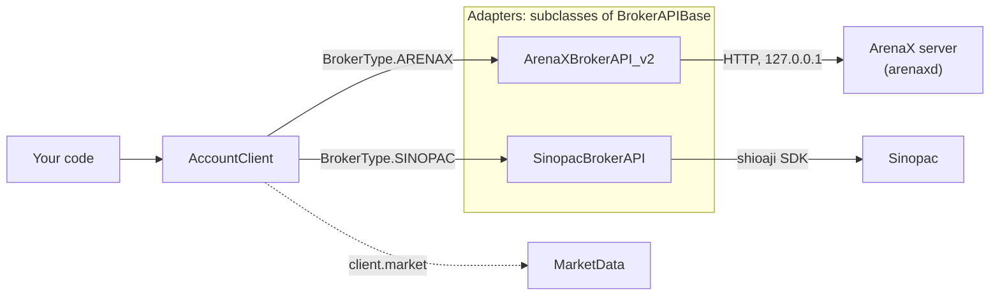

# Connect to a broker

This page starts ArenaX, the simulated broker, and connects to it from
Python to read the account balance. Use two terminals: one for ArenaX, one
for your code.

## How `AccountClient` reaches a broker {#how-accountclient-reaches-a-broker}

`AccountClient` is the only class your code uses. `BrokerType` picks an
adapter that implements `BrokerAPIBase`; the adapter converts CJTrade's
models (`Order`, `Position`, `Kbar`, ...) to and from the broker's own API.
Prices go through `client.market`, a `MarketData` source chosen
independently of the broker.



Adding a broker means writing one more adapter; see the
[Broker interface](../reference/broker-base.md).

## Step 1: start ArenaX

In the first terminal, from the `CJTrade` folder:

```sh
uv run arenaxd
```

This starts ArenaX with the default `demo` backend, which:

1. picks a trading day 11 to 20 days in the past,
2. downloads that period's 1-minute bars from Yahoo Finance (no account
   needed) into the price cache,
3. opens a fresh simulated account with NT$100,000,
4. listens on `127.0.0.1:8801` (local connections only).

Expected output after a few seconds (shortened; your dates will differ):

```text
[INFO][...] ArenaX.server: market data: yfinance
[INFO][...] ArenaX.backend.demo: market time: ... mock_current_time=2026-11-13 09:00:00 ... playback_speed=120.0 ...
[INFO][...] ArenaX.server: starting on 127.0.0.1:8801, backend=demo
[INFO][...] ArenaX.backend.state: fresh account
[INFO][...] ArenaX.backend: sim env started
```

`mock_current_time` is ArenaX's simulated now; `playback_speed=120.0` means
one real second is two market minutes. Keep this terminal running.

??? question "I see `[ERROR] yfinance: ... possibly delisted; no price data found`"
    Yahoo has no bars for some of the requested days, usually a weekend or
    a holiday. ArenaX continues with the days it received. The error is
    harmless once `sim env started` appears.

## Step 2: connect from Python

In the second terminal, save this as `hello.py` and run
`uv run python hello.py`:

```python
from cjtrade.pkgs.brokers.account_client import AccountClient, BrokerType

client = AccountClient(BrokerType.ARENAX, api_key="testkey123")
client.connect()

print("broker:", client.get_broker_name())
print("balance:", client.get_balance())
print("positions:", client.get_positions())
print("market time:", client.get_market_time()["mock_current_time"])

client.disconnect()
```

- `BrokerType.ARENAX` selects the broker; the rest of the code is the same
  for every broker. `testkey123` is the API key every ArenaX server accepts
  by default.
- Pair every `connect()` with `disconnect()`.
- `get_balance()` returns cash; `get_positions()` returns holdings.
- `get_market_time()` returns ArenaX's simulated market time.

Expected output:

```text
broker: arenax (8801)
balance: 100000.0
positions: []
market time: 2026-11-13 09:24:43.668600
```

A fresh account has NT$100,000 and no positions. The simulated clock runs
as long as ArenaX is up, so a second run a few seconds later shows a later
market time.

!!! note "The account lives as long as the server"
    Disconnecting and connecting again keeps the same balance and positions.
    Restarting `arenaxd` opens a fresh account on a new random day.

??? question "`connect()` fails with `Connection refused`"
    ArenaX is not running, or not ready yet. Wait until the first terminal
    shows `sim env started`, then retry. See
    [Troubleshooting](troubleshooting.md) for other errors.

## Sinopac (a real broker)

Switching to Sinopac changes only the client constructor. It requires the
`sinopac` extra and the API key, secret and certificate from
[Sinopac's API portal](https://ai.sinotrade.com.tw/python/Main/index.aspx#pag4):

```python
client = AccountClient(
    BrokerType.SINOPAC,
    api_key="...", secret_key="...",
    ca_path="/path/to/Sinopac.pfx", ca_passwd="...",
    simulation=True,      # Sinopac's sandbox: orders are not real
)
client.connect()
```

!!! danger "`simulation=False` is your real account"
    With `simulation=False` every order is a real order with real money.
    Keep `simulation=True` until your code has run correctly on ArenaX and
    on the sandbox.

Keep secrets out of code by putting them in a settings file; see
[Configuration and paths](../reference/config.md).

Next: [Account and orders](account-and-orders.md).
