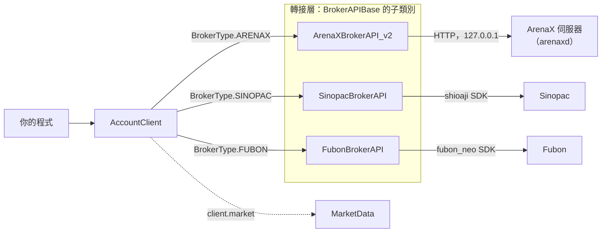

# 連線到券商

本頁啟動模擬券商 ArenaX，並從 Python 連線讀取帳戶餘額。需要兩個終端機：一個執行 ArenaX，另一個執行你的程式。

## `AccountClient` 如何連到券商 {#how-accountclient-reaches-a-broker}

程式只會用到 `AccountClient` 這個類別。`BrokerType` 決定使用哪個實作 `BrokerAPIBase` 的轉接層（adapter）；轉接層負責在 CJTrade 的資料模型（`Order`、`Position`、`Kbar` 等）和券商自己的 API 之間轉換。價格則經由 `client.market` 取得，它是一個與券商分開選擇的 `MarketData` 來源。



新增一家券商，只要多寫一個轉接層，Fubon 就是這樣加入的；見[券商介面](../reference/broker-base.md)。

## 步驟 1：啟動 ArenaX

在第一個終端機中，於 `CJTrade` 資料夾內執行：

```sh
uv run arenaxd
```

這會以預設的 `demo` 後端啟動 ArenaX，它會：

1. 挑選 11 到 20 天前的某個交易日，
2. 從 Yahoo Finance 下載該期間的 1 分鐘 K 棒（不需要帳戶），存入價格快取，
3. 開立一個含 NT$100,000 的全新模擬帳戶，
4. 在 `127.0.0.1:8801` 監聽（僅接受本機連線）。

數秒後的預期輸出（有省略，日期會不同）：

```text
[INFO][...] ArenaX.server: market data: yfinance
[INFO][...] ArenaX.backend.demo: market time: ... mock_current_time=2026-11-13 09:00:00 ... playback_speed=120.0 ...
[INFO][...] ArenaX.server: starting on 127.0.0.1:8801, backend=demo
[INFO][...] ArenaX.backend.state: fresh account
[INFO][...] ArenaX.backend: sim env started
```

`mock_current_time` 是 ArenaX 的模擬時間；`playback_speed=120.0` 表示真實的 1 秒等於市場的 2 分鐘。讓這個終端機保持執行。

??? question "出現 `[ERROR] yfinance: ... possibly delisted; no price data found`"
    Yahoo 缺少部分請求日期的 K 棒，通常是週末或假日。ArenaX 會以已取得的日期繼續執行。只要之後出現 `sim env started`，這個錯誤即可忽略。

## 步驟 2：從 Python 連線

在第二個終端機中，將下列程式存成 `hello.py`，以 `uv run python hello.py` 執行：

```python
from cjtrade.pkgs.brokers.account_client import AccountClient, BrokerType

client = AccountClient(BrokerType.ARENAX, api_key="testkey123")
client.connect()

print("broker:", client.get_broker_name())
print("balance:", client.get_balance())
print("positions:", client.get_positions())
print("market time:", client.get_market_time()["mock_current_time"])

client.disconnect()
```

- `BrokerType.ARENAX` 選擇券商，其餘程式碼對所有券商都相同。`testkey123` 是所有 ArenaX 伺服器預設接受的 API 金鑰。
- 每個 `connect()` 都要搭配 `disconnect()`。
- `get_balance()` 回傳現金，`get_positions()` 回傳持股。
- `get_market_time()` 回傳 ArenaX 的模擬市場時間。

預期輸出：

```text
broker: arenax (8801)
balance: 100000.0
positions: []
market time: 2026-11-13 09:24:43.668600
```

新帳戶有 NT$100,000，沒有持股。只要 ArenaX 在執行，模擬時鐘就持續推進，數秒後再執行一次，市場時間會較晚。

!!! note "帳戶跟著伺服器存在"
    斷線後重新連線，餘額和持股不變。重新啟動 `arenaxd` 則會在隨機挑選的新日期開立全新帳戶。

??? question "`connect()` 失敗，出現 `Connection refused`"
    ArenaX 未執行或尚未就緒。等第一個終端機顯示 `sim env started` 後再重試。其他錯誤請見[疑難排解](troubleshooting.md)。

## 實盤券商

改用正式帳戶時，只需更換 `AccountClient` 的建構參數：`BrokerType.SINOPAC` 或 `BrokerType.FUBON`，以及該券商的登入資訊。兩家券商的連線程式碼、各轉接層負責的轉換，以及各券商支援的功能，請見[實盤券商](live-brokers.md)。

密鑰不要寫在程式碼裡，請放在設定檔中，詳見[設定與路徑](../reference/config.md)。

下一步：[實盤券商](live-brokers.md)，或[帳戶與委託](account-and-orders.md)。
