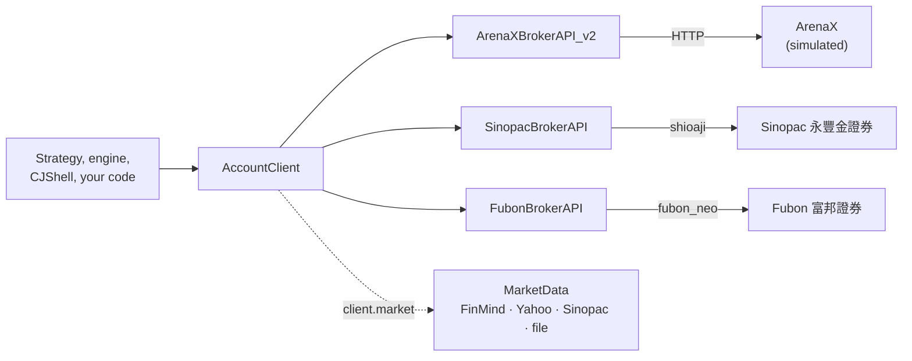

# Live brokers

Code written against `AccountClient` does not depend on a broker. The broker is
one argument, `BrokerType`; behind it, an adapter translates CJTrade's models to
the broker's SDK and back. Moving a strategy from ArenaX to a live account, or
from one brokerage to another, changes that argument and the credentials, and
nothing else.



## What each adapter converts

Every adapter maps the same things, so the rest of CJTrade sees one model:

| CJTrade | Sinopac (`shioaji`) | Fubon (`fubon_neo`) |
|---|---|---|
| `Order.action` BUY / SELL | `Action.Buy` / `Sell` | `BSAction.Buy` / `Sell` |
| `Order.order_lot` Common / IntraDayOdd | `StockOrderLot.Common` / `IntradayOdd` | `MarketType.Common` / `IntradayOdd` |
| `Order.quantity` (lots for Common, shares for odd lots) | the same units | always shares: Common × 1,000 |
| `Order.price` (float) | float | string (`"66.5"`) |
| `Order.price_type` LMT / MKT | `StockPriceType.LMT` / `MKT` | `PriceType.Limit` / `Market` |
| `Order.order_type` ROD / IOC / FOK | `OrderType.ROD` / `IOC` / `FOK` | `TimeInForce.ROD` / `IOC` / `FOK` |
| `OrderStatus` | from `Status` (PendingSubmit, Submitted, Filled, ...) | from the numeric `status` (0, 10, 30, 40, 50, 90, ...) and the filled quantity |
| CJTrade order id ↔ broker id | shioaji order id, in the mirror database | `<date>:<seq_no>`, in the mirror database, plus a `user_def` tag |
| Fill reports → `OrderEvent` | order and deal callbacks | `set_on_order`, `set_on_order_changed`, `set_on_filled` |

The mirror database (`paths.mirror_db_path("<broker>")`) records every order
placed through CJTrade and the broker id it maps to, so orders can still be
found, listed and cancelled after a restart.

## Capabilities

| | ArenaX | Sinopac | Fubon |
|---|---|---|---|
| Extra | none | `sinopac` | `fubon` |
| Orders: place, cancel, list, `sync_state` | ✓ | ✓ | ✓ |
| Balance and positions | ✓ | ✓ | ✓ |
| Quotes (`get_snapshots`, `get_bid_ask`) | ✓ | ✓, five levels | ✓, best level only |
| Historical bars (`client.market`) | ✓ | ✓ | – pass `market=` (FinMind, Yahoo, ...) |
| Fill and status callbacks | – poll `sync_state()` | ✓ | ✓ |
| Sandbox | it is one | `simulation=True` | none: every order is real |
| Partial fills reported as `PARTIAL` | – fills in full | ✓ | ✓ |
| Tested against a live account | n/a | ✓ | not yet |

## Sinopac

Requires the `sinopac` extra and the API key, secret and certificate from
[Sinopac's API portal](https://ai.sinotrade.com.tw/python/Main/index.aspx#pag4):

```python
from cjtrade.pkgs.brokers.account_client import AccountClient, BrokerType

client = AccountClient(
    BrokerType.SINOPAC,
    api_key="...", secret_key="...",
    ca_path="/path/to/Sinopac.pfx", ca_passwd="...",
    simulation=True,      # Sinopac's sandbox: orders are not real
)
client.connect()
```

The same arguments from settings: `AccountClient(BrokerType.SINOPAC,
**sinopac_config())`, with `SINOPAC_API_KEY`, `SINOPAC_SECRET_KEY`,
`SINOPAC_CA_CERT_PATH`, `SINOPAC_CA_PASSWORD` and `SINOPAC_SIMULATION`.

!!! danger "`simulation=False` is your real account"
    With `simulation=False` every order is a real order with real money.
    Keep `simulation=True` until your code has run correctly on ArenaX and
    on the sandbox.

## Fubon

Requires the `fubon` extra (`pip install 'cjtrade[fubon]'`, which installs
[`fubon-neo`](https://pypi.org/project/fubon-neo/)), a Fubon securities
account with the API agreement signed, and its certificate. See
[Fubon's Trade API documentation](https://www.fbs.com.tw/TradeAPI/docs/welcome/)
for the account setup.

```python
from cjtrade.pkgs.brokers.account_client import AccountClient, BrokerType
from cjtrade.pkgs.marketdata import Cached, Fallback, FinMindMarketData, YFinanceMarketData

client = AccountClient(
    BrokerType.FUBON,
    personal_id="A123456789",           # 身分證字號
    api_key="...",                      # or password="..." for a password login
    cert_path="/path/to/A123456789.pfx",
    cert_pass="...",                    # defaults to personal_id in the SDK
    market=Cached(Fallback([FinMindMarketData(), YFinanceMarketData()])),
)
client.connect()
print(client.get_balance())
```

| Argument | Meaning |
|---|---|
| `personal_id` | the account holder's ID number |
| `api_key` or `password` | API-key login (`apikey_login`) or password login (`login`) |
| `cert_path`, `cert_pass` | the `.pfx` certificate and its password |
| `account` | the account number to trade when the login returns several; default the first stock account |
| `market` | where bars come from; the Fubon adapter serves quotes, not bars |

To read these from settings instead (`FUBON_PERSONAL_ID`, `FUBON_API_KEY` or
`FUBON_PASSWORD`, `FUBON_CERT_PATH`, `FUBON_CERT_PASSWORD`, `FUBON_ACCOUNT`;
see [Configuration and paths](../reference/config.md)):

```python
from cjtrade.pkgs.config.broker_settings import fubon_config
from cjtrade.pkgs.config.config_loader import load_supported_config_files

load_supported_config_files()
client = AccountClient(BrokerType.FUBON, **fubon_config(), market=...)
```

Behaviour specific to Fubon:

- Orders are checked against Fubon's rules before they are sent: odd lots
  take 1 to 999 shares and ROD only, board lots 1 to 499 lots, and market
  orders are board-lot only. A violation comes back as `REJECTED` without
  reaching the broker.
- `get_bid_ask` returns the best bid and ask only.
- `list_orders()` returns today's orders on the account, including ones
  placed elsewhere; those have `id='N/A'`.

!!! danger "There is no Fubon sandbox"
    `fubon_neo` has no simulation flag, so every order placed through
    `BrokerType.FUBON` is a real order. The adapter is unit-tested against
    the SDK's own order and enum types, but has not yet been run against a
    live account: start with odd-lot orders far from the market.

## Adding a broker

An adapter subclasses `BrokerAPIBase` and implements its abstract methods;
`AccountClient` then needs one more `BrokerType` branch. See the
[Broker interface](../reference/broker-base.md) and the
[brokers README](https://github.com/jackiesogi/CJTrade/blob/master/src/cjtrade/pkgs/brokers/README.md).

Next: [Account and orders](account-and-orders.md).
