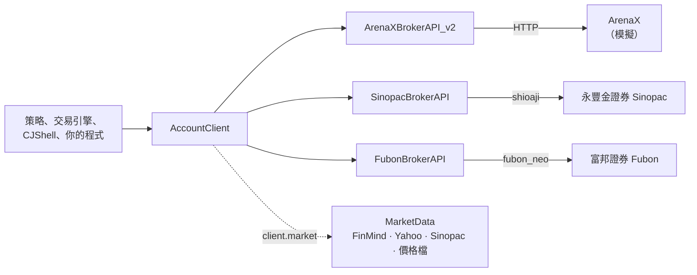

# 實盤券商

以 `AccountClient` 撰寫的程式不綁定任何券商。券商只是一個參數 `BrokerType`；在它背後，由轉接層（adapter）負責在 CJTrade 的資料模型和券商 SDK 之間轉換。把策略從 ArenaX 搬到正式帳戶，或從一家券商換到另一家，只要改這個參數和登入資訊，其他程式碼都不用動。



## 轉接層負責的轉換

每個轉接層轉換的項目相同，因此 CJTrade 的其他部分只需要面對一套模型：

| CJTrade | Sinopac（`shioaji`） | Fubon（`fubon_neo`） |
|---|---|---|
| `Order.action` BUY / SELL | `Action.Buy` / `Sell` | `BSAction.Buy` / `Sell` |
| `Order.order_lot` Common / IntraDayOdd | `StockOrderLot.Common` / `IntradayOdd` | `MarketType.Common` / `IntradayOdd` |
| `Order.quantity`（整股以張、零股以股計） | 單位相同 | 一律以股計：整股 × 1,000 |
| `Order.price`（float） | float | 字串（`"66.5"`） |
| `Order.price_type` LMT / MKT | `StockPriceType.LMT` / `MKT` | `PriceType.Limit` / `Market` |
| `Order.order_type` ROD / IOC / FOK | `OrderType.ROD` / `IOC` / `FOK` | `TimeInForce.ROD` / `IOC` / `FOK` |
| `OrderStatus` | 由 `Status`（PendingSubmit、Submitted、Filled 等）轉換 | 由數字 `status`（0、10、30、40、50、90 等）與已成交數量判斷 |
| CJTrade 委託 id ↔ 券商 id | shioaji 的 order id，存於鏡像資料庫 | `<date>:<seq_no>`，存於鏡像資料庫，並附上 `user_def` 標記 |
| 成交回報 → `OrderEvent` | 委託與成交 callback | `set_on_order`、`set_on_order_changed`、`set_on_filled` |

鏡像資料庫（`paths.mirror_db_path("<broker>")`）記錄每一筆經由 CJTrade 送出的委託，以及它對應的券商 id，因此程式重啟後仍能找到、列出並取消這些委託。

## 功能比較

| | ArenaX | Sinopac | Fubon |
|---|---|---|---|
| 選用套件 | 不需要 | `sinopac` | `fubon` |
| 委託：下單、取消、列出、`sync_state` | ✓ | ✓ | ✓ |
| 餘額與持股 | ✓ | ✓ | ✓ |
| 報價（`get_snapshots`、`get_bid_ask`） | ✓ | ✓，五檔 | ✓，僅最佳一檔 |
| 歷史 K 棒（`client.market`） | ✓ | ✓ | –，請傳入 `market=`（FinMind、Yahoo 等） |
| 成交與狀態 callback | –，請輪詢 `sync_state()` | ✓ | ✓ |
| 沙盒（模擬環境） | 本身就是模擬 | `simulation=True` | 無：每筆委託都是真的 |
| 部分成交回報為 `PARTIAL` | –，一律全部成交 | ✓ | ✓ |
| 已在正式帳戶上驗證 | 不適用 | ✓ | 尚未 |

## Sinopac

需要安裝 `sinopac` 選用套件，並從 [Sinopac 的 API 網站](https://ai.sinotrade.com.tw/python/Main/index.aspx#pag4)取得 API 金鑰、密鑰和憑證：

```python
from cjtrade.pkgs.brokers.account_client import AccountClient, BrokerType

client = AccountClient(
    BrokerType.SINOPAC,
    api_key="...", secret_key="...",
    ca_path="/path/to/Sinopac.pfx", ca_passwd="...",
    simulation=True,      # Sinopac 的沙盒：委託不是真的
)
client.connect()
```

從設定讀取相同的參數：`AccountClient(BrokerType.SINOPAC, **sinopac_config())`，對應的設定為 `SINOPAC_API_KEY`、`SINOPAC_SECRET_KEY`、`SINOPAC_CA_CERT_PATH`、`SINOPAC_CA_PASSWORD` 和 `SINOPAC_SIMULATION`。

!!! danger "`simulation=False` 就是你的正式帳戶"
    設成 `simulation=False` 時，每一筆委託都是動用真實資金的真實委託。在程式於 ArenaX 和沙盒上都正確執行之前，請保持 `simulation=True`。

## Fubon

需要安裝 `fubon` 選用套件（`pip install 'cjtrade[fubon]'`，會安裝 [`fubon-neo`](https://pypi.org/project/fubon-neo/)）、已簽署 API 使用同意書的富邦證券帳戶，以及該帳戶的憑證。開戶與申請流程請見[富邦新一代 API 文件](https://www.fbs.com.tw/TradeAPI/docs/welcome/)。

```python
from cjtrade.pkgs.brokers.account_client import AccountClient, BrokerType
from cjtrade.pkgs.marketdata import Cached, Fallback, FinMindMarketData, YFinanceMarketData

client = AccountClient(
    BrokerType.FUBON,
    personal_id="A123456789",           # 身分證字號
    api_key="...",                      # 或以 password="..." 用密碼登入
    cert_path="/path/to/A123456789.pfx",
    cert_pass="...",                    # SDK 預設為 personal_id
    market=Cached(Fallback([FinMindMarketData(), YFinanceMarketData()])),
)
client.connect()
print(client.get_balance())
```

| 參數 | 意義 |
|---|---|
| `personal_id` | 帳戶持有人的身分證字號 |
| `api_key` 或 `password` | API 金鑰登入（`apikey_login`）或密碼登入（`login`） |
| `cert_path`、`cert_pass` | `.pfx` 憑證及其密碼 |
| `account` | 登入回傳多個帳號時要交易的帳號；預設為第一個證券帳號 |
| `market` | K 棒的來源；Fubon 轉接層只提供報價，不提供 K 棒 |

改從設定讀取（`FUBON_PERSONAL_ID`、`FUBON_API_KEY` 或 `FUBON_PASSWORD`、`FUBON_CERT_PATH`、`FUBON_CERT_PASSWORD`、`FUBON_ACCOUNT`；見[設定與路徑](../reference/config.md)）：

```python
from cjtrade.pkgs.config.broker_settings import fubon_config
from cjtrade.pkgs.config.config_loader import load_supported_config_files

load_supported_config_files()
client = AccountClient(BrokerType.FUBON, **fubon_config(), market=...)
```

Fubon 特有的行為：

- 委託送出前會先依富邦的規則檢查：零股限 1 到 999 股且只能 ROD，整股限 1 到 499 張，市價單只限整股。不符合規則的委託直接回傳 `REJECTED`，不會送到券商。
- `get_bid_ask` 只回傳最佳一檔買賣價。
- `list_orders()` 回傳帳戶當日的所有委託，包含不是經由 CJTrade 送出的委託，這些委託的 `id` 為 `'N/A'`。

!!! danger "Fubon 沒有沙盒"
    `fubon_neo` 沒有模擬環境的開關，因此經由 `BrokerType.FUBON` 送出的每一筆委託都是真實委託。這個轉接層已用 SDK 本身的委託與列舉型別做過單元測試，但尚未在正式帳戶上執行過：請先用離市價很遠的零股委託試驗。

## 新增券商

轉接層繼承 `BrokerAPIBase` 並實作其抽象方法，`AccountClient` 再多一個 `BrokerType` 分支即可。詳見[券商介面](../reference/broker-base.md)和 [brokers README](https://github.com/jackiesogi/CJTrade/blob/master/src/cjtrade/pkgs/brokers/README.md)。

下一步：[帳戶與委託](account-and-orders.md)。
