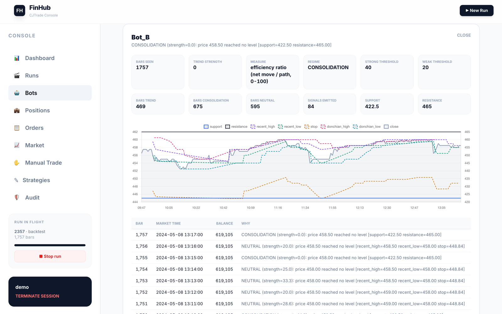

# CJShell and FinHub

Two no-code front ends: **CJShell**, a command line for one broker account,
and **FinHub**, a web UI for the trading engine.

## CJShell {#cjshell}

CJShell connects to a broker and runs account commands such as `balance` or
`buy`. Use it to inspect an account or place manual orders.

### Set it up once

CJShell reads its connection settings from a `.cjconf` file. Generate one for
ArenaX:

```sh
bash scripts/gen_config.sh arenax
```

This writes `arenax_system.cjconf` to the current directory with
`API_KEY = testkey123` set and the other keys blank. The other keys are only
needed for the `llm` command or for Sinopac.

### Run one command, or many

With ArenaX running ([Connect to a broker](connect.md)), a command after the
options runs once and exits:

```sh
uv run cjshell --broker=arenax balance
```

Expected output:

```text
[INFO][...] config: loaded cfg file .../arenax_system.cjconf
[INFO][...] brokers.arenax: connected
Executing: balance
Account Balance: 97562.6
[INFO][...] brokers.arenax: disconnected
```

Without a command, CJShell opens an interactive prompt; `help` lists the
commands and `exit` quits:

```sh
uv run cjshell --broker=arenax
```

Common commands:

| Command | Does |
|---|---|
| `balance` | show cash |
| `lspos` | list positions with their profit or loss |
| `lsodr [n]` | list the last orders and their status |
| `buy <symbol> <price> <quantity>` | place a limit buy (odd lots, so quantity is in shares) |
| `sell <symbol> <price> <quantity>` | place a limit sell |
| `cancel` | cancel every open order |
| `ohlcv <symbol>` | latest quote |
| `bidask <symbol>` | best bid and ask |
| `help [command]` | every command, or one in detail |

`lspos` after buying one share of 2330:

```text
Executing: lspos
  symbol  quantity  avg_cost  current_price  market_value  unrealized_pnl
0   2330         1    2417.4         2360.0        2360.0           -57.4
Total Cost: 2,417.400
Market Value: 2,360.000
Total Unrealized PnL: -57.400 (-2.37%)
```

!!! danger "On Sinopac, CJShell places real orders without asking"
    `uv run cjshell --broker=sinopac` reads `sinopac_system.cjconf` (generate
    it with `bash scripts/gen_config.sh sinopac` and fill in your keys).
    `buy` sends a real order immediately, with no confirmation. The generated
    file sets `SIMULATION = n`, which is your real account; set
    `SIMULATION = y` to use Sinopac's sandbox.

## FinHub {#finhub}

FinHub is a web UI for the trading engine: pick bots, symbols and dates in a
form, start a run, and follow each bot's decisions, orders and P&L live.
Every run is stored for later comparison.

```sh
uv run finhub
```

Open <http://127.0.0.1:8000>, register a user (stored locally) and sign in.
FinHub starts the ArenaX server and the engine itself; nothing else needs to
be running.

**New Run** takes symbols, dates and speed. The **Dashboard** tracks the run:
replay progress, account equity and P&L, round trips, risk gate state, and
the equity curve.


**Bots** lists each bot. A bot's page shows the reason for its decision on
every bar, the values its strategy tracks, and the lines it plots over the
price:



**Strategies** is the editor for your own strategy files. A new account
starts with the three example strategies. **Check** runs the same checks as
`strategy-tool check`; only strategies marked **Enabled** take part in a run:


**Runs** keeps every run with its result and full log:


FinHub binds to `127.0.0.1` only. For remote access, forward the port over
SSH: `ssh -L 8000:127.0.0.1:8000 <host>`.

!!! note "Warnings while no run is going"
    With no run in progress, FinHub logs `broker unreachable` and
    `engine status API ... All connection attempts failed` every few seconds.
    This is expected: there is no broker or engine to poll until a run
    starts.

Settings are documented in the
[FinHub README](https://github.com/jackiesogi/CJTrade/blob/master/src/cjtrade/apps/FinHub/README.md).

Next: [Troubleshooting](troubleshooting.md), or the full list of
[Commands](../reference/commands.md).
