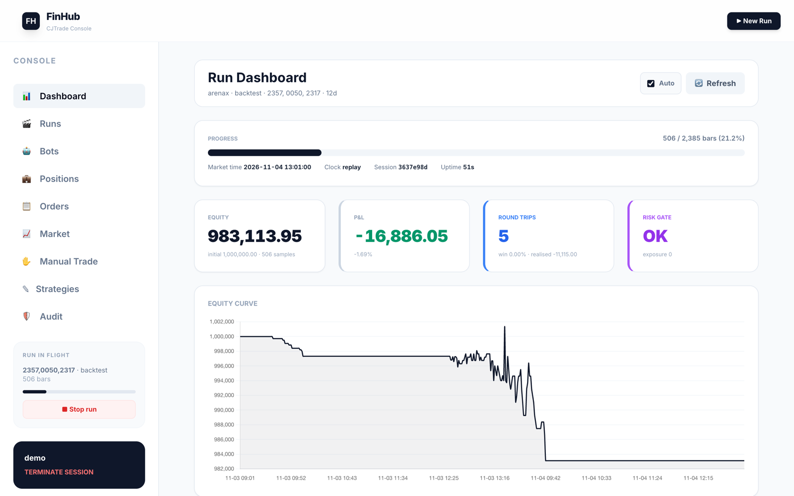
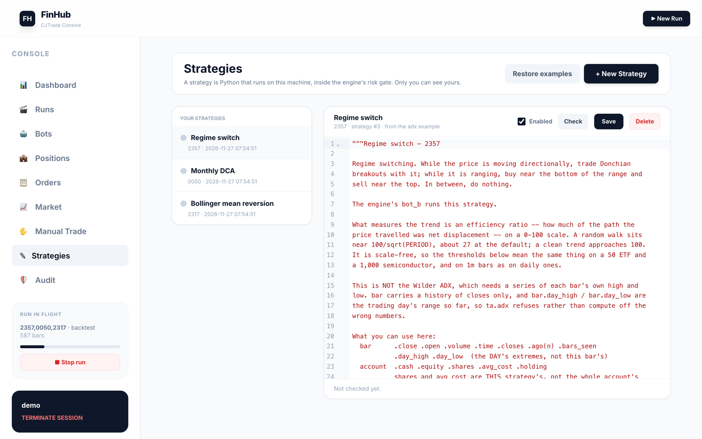
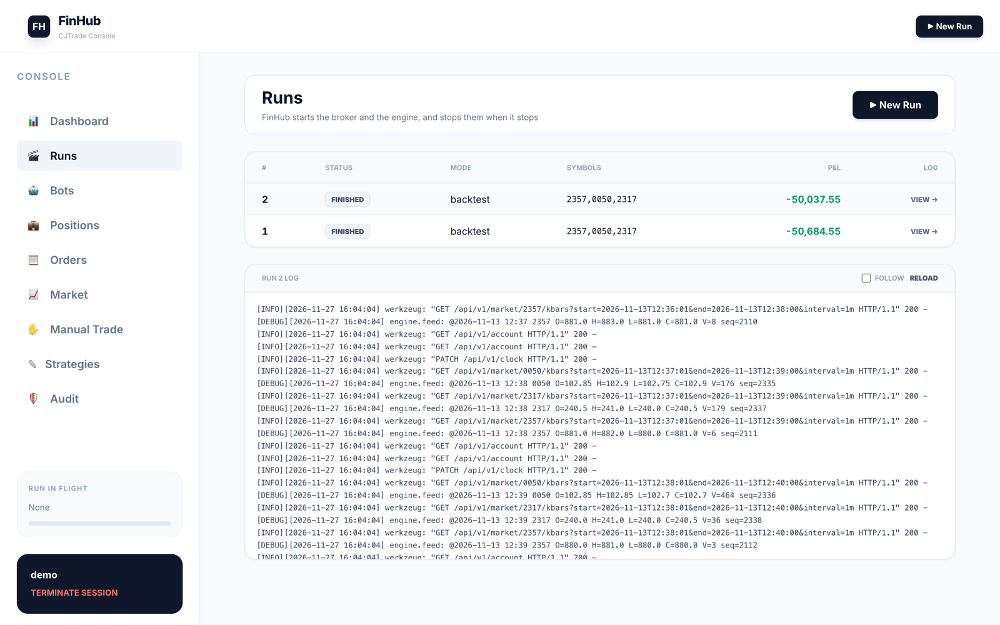

# CJShell and FinHub

Two tools let you use CJTrade without writing code: **CJShell**, a command
line for an account, and **FinHub**, a web page for the trading engine.

## CJShell {#cjshell}

CJShell connects to a broker and lets you type commands such as `balance` or
`buy`. It is the quickest way to look at an account or place a manual order.

### Set it up once

CJShell reads its connection settings from a settings file. Create one for
ArenaX:

```sh
bash scripts/gen_config.sh arenax
```

This writes `arenax_system.cjconf` in the current folder, with
`API_KEY = testkey123` filled in and the other lines blank. You only need to
fill them in for the `llm` command or for Sinopac.

### Run one command, or many

With ArenaX running ([Connect to a broker](connect.md)), give a command after
the options to run it once:

```sh
uv run cjshell --broker=arenax balance
```

Expected output:

```text
[INFO][...] config: loaded cfg file .../arenax_system.cjconf
[INFO][...] brokers.arenax: connected
Executing: balance
Account Balance: 97562.6
[INFO][...] brokers.arenax: disconnected
```

Leave the command out to get an interactive prompt where you can type one
command after another; `help` lists them and `exit` leaves:

```sh
uv run cjshell --broker=arenax
```

The commands you will use most:

| Command | Does |
|---|---|
| `balance` | show cash |
| `lspos` | list positions with their profit or loss |
| `lsodr [n]` | list the last orders and their status |
| `buy <symbol> <price> <quantity>` | place a limit buy (odd lots, so quantity is in shares) |
| `sell <symbol> <price> <quantity>` | place a limit sell |
| `cancel` | cancel every open order |
| `ohlcv <symbol>` | latest quote |
| `bidask <symbol>` | best bid and ask |
| `help [command]` | every command, or one in detail |

Example, `lspos` after buying one share of 2330:

```text
Executing: lspos
  symbol  quantity  avg_cost  current_price  market_value  unrealized_pnl
0   2330         1    2417.4         2360.0        2360.0           -57.4
Total Cost: 2,417.400
Market Value: 2,360.000
Total Unrealized PnL: -57.400 (-2.37%)
```

!!! danger "On Sinopac, CJShell places real orders without asking"
    `uv run cjshell --broker=sinopac` uses `sinopac_system.cjconf` (create it
    with `bash scripts/gen_config.sh sinopac` and fill in your keys). A
    `buy` there is a real order, sent immediately with no confirmation. The
    generated file says `SIMULATION = n`, your real account; change it to
    `SIMULATION = y` to use Sinopac's sandbox.

## FinHub {#finhub}

FinHub is a web page for the trading engine. You choose the bots, symbols
and dates in a form, start the run, and watch each bot's decisions, orders
and profit while it runs. Every run is kept, so you can compare them later.

```sh
uv run finhub
```

Then open <http://127.0.0.1:8000>, register a user (it stays on your
computer), and sign in. FinHub starts the ArenaX server and the engine
itself, so nothing else needs to be running.

Press **New Run**, choose symbols, dates and speed, and start. The
**Dashboard** follows the run: how far the replay has got, the account's
equity and profit, round trips, the risk gate, and the equity curve.



**Bots** shows each bot. Open one to see why it did what it did on every
bar, the numbers its strategy watches, and the lines it plots over the
price:


**Strategies** is where you write and edit your own strategy files. A new
account starts with the three example strategies; **Check** runs the same
checks as `strategy-tool check`, and only strategies marked **Enabled** take
part in a run:



**Runs** keeps every run with its result and its full log:



FinHub only listens on your own computer (`127.0.0.1`). To open it from
another machine, forward the port over SSH:
`ssh -L 8000:127.0.0.1:8000 <host>`.

!!! note "Warnings while no run is going"
    With no run in progress, FinHub's log prints
    `broker unreachable` and `engine status API ... All connection attempts
    failed` every few seconds. Nothing is wrong: there is simply no broker or
    engine to ask until you start a run.

Its settings are in the
[FinHub README](https://github.com/jackiesogi/CJTrade/blob/master/src/cjtrade/apps/FinHub/README.md).

Next: [Troubleshooting](troubleshooting.md), or look things up in
[Commands](../reference/commands.md).
