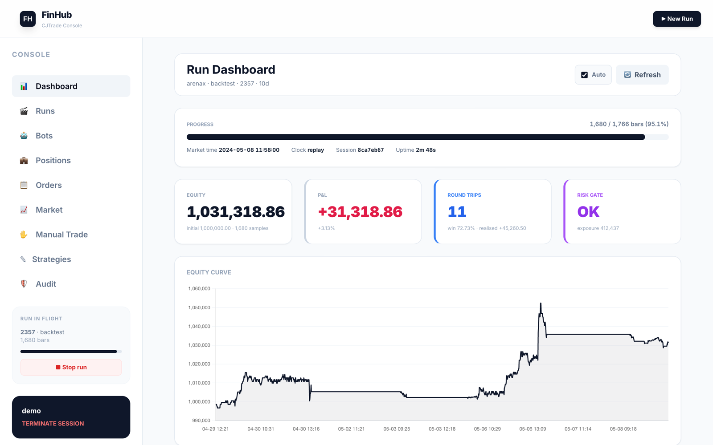
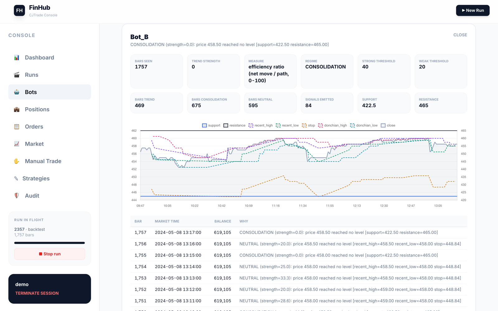
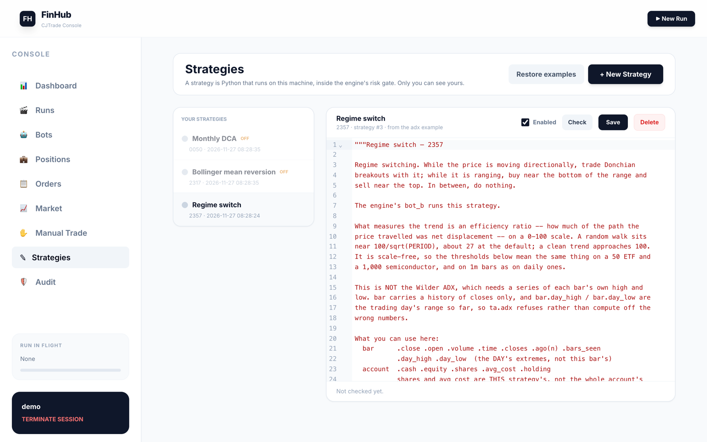
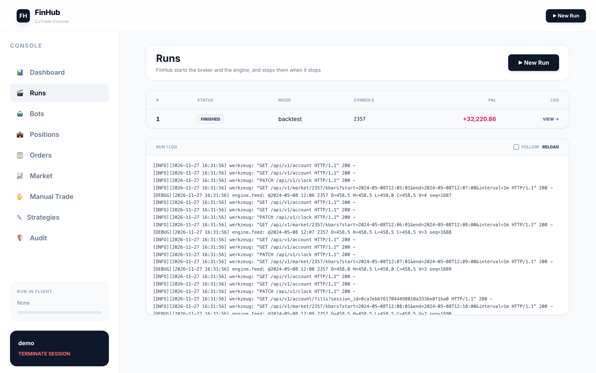

# CJShell 與 FinHub

兩個不需寫程式的操作介面：**CJShell** 是單一券商帳戶的命令列，**FinHub** 是交易引擎的
網頁介面。

## CJShell {#cjshell}

CJShell 連線到券商後執行 `balance`、`buy` 等帳戶指令，用於查看帳戶或手動下委託。

### 第一次使用前的設定

CJShell 從 `.cjconf` 設定檔讀取連線設定。為 ArenaX 產生一份：

```sh
bash scripts/gen_config.sh arenax
```

這會在目前目錄寫出 `arenax_system.cjconf`，`API_KEY = testkey123` 已設定，其餘
鍵留空。只有使用 `llm` 指令或永豐金證券 Sinopac 時才需要填寫其餘的鍵。

### 執行一個指令，或連續執行多個

ArenaX 執行中時（見[連線到券商](connect.md)），在選項後接上指令，會執行一次後結束：

```sh
uv run cjshell --broker=arenax balance
```

預期輸出：

```text
[INFO][...] config: loaded cfg file .../arenax_system.cjconf
[INFO][...] brokers.arenax: connected
Executing: balance
Account Balance: 97562.6
[INFO][...] brokers.arenax: disconnected
```

不接指令則進入互動式提示字元；`help` 列出所有指令，`exit` 離開：

```sh
uv run cjshell --broker=arenax
```

常用指令：

| 指令 | 作用 |
|---|---|
| `balance` | 顯示現金 |
| `lspos` | 列出持股及各自的損益 |
| `lsodr [n]` | 列出最近的委託及其狀態 |
| `buy <symbol> <price> <quantity>` | 下限價買單（零股，所以數量單位是股） |
| `sell <symbol> <price> <quantity>` | 下限價賣單 |
| `cancel` | 取消所有未成交的委託 |
| `ohlcv <symbol>` | 最新報價 |
| `bidask <symbol>` | 最佳買賣價 |
| `help [command]` | 列出所有指令，或顯示單一指令的詳細說明 |

買進一股 2330 後執行 `lspos`：

```text
Executing: lspos
  symbol  quantity  avg_cost  current_price  market_value  unrealized_pnl
0   2330         1    2417.4         2360.0        2360.0           -57.4
Total Cost: 2,417.400
Market Value: 2,360.000
Total Unrealized PnL: -57.400 (-2.37%)
```

!!! danger "在 Sinopac 上，CJShell 會直接下真的委託，不會再確認"
    `uv run cjshell --broker=sinopac` 讀取 `sinopac_system.cjconf`（以
    `bash scripts/gen_config.sh sinopac` 產生，再填入金鑰）。`buy` 會立即送出
    真實委託，不經確認。產生的檔案預設為 `SIMULATION = n`，即正式帳戶；改為
    `SIMULATION = y` 才會使用永豐的沙盒（模擬環境）。

## FinHub {#finhub}

FinHub 是交易引擎的網頁介面：在表單中選定 bot、股票代號和日期後啟動執行，即時追蹤
每個 bot 的決策、委託和損益。每次執行都會保存，供日後比較。

```sh
uv run finhub
```

開啟 <http://127.0.0.1:8000>，註冊使用者（資料只存在本機）並登入。FinHub 會自行
啟動 ArenaX 伺服器和交易引擎，不需事先執行其他程式。

**New Run** 設定股票代號、日期和速度。**Dashboard** 追蹤執行狀況：回放進度、帳戶
權益與損益、一買一賣的次數、風控閘門的狀態，以及權益曲線。



**Bots** 頁列出每個 bot。bot 的詳細頁顯示它在每根 K 棒上的決策原因、策略追蹤的
數值，以及疊在價格上的線：



**Strategies** 頁是自訂策略檔的編輯器。新帳戶預設附有三個範例策略。**Check** 執行
與 `strategy-tool check` 相同的檢查；只有勾選 **Enabled** 的策略會參與執行：



**Runs** 頁保存每次執行的結果和完整 log：



FinHub 只綁定 `127.0.0.1`。需要從其他機器存取時，以 SSH 轉送埠（port）：
`ssh -L 8000:127.0.0.1:8000 <host>`。

!!! note "沒有執行中的工作時出現的警告"
    沒有執行中的工作時，FinHub 的日誌每隔幾秒會印出 `broker unreachable` 和
    `engine status API ... All connection attempts failed`。這是預期行為：
    執行啟動前，沒有券商或引擎可以查詢。

設定說明見
[FinHub README](https://github.com/jackiesogi/CJTrade/blob/master/src/cjtrade/apps/FinHub/README.md)。

下一步：[疑難排解](troubleshooting.md)，或查看完整的[指令](../reference/commands.md)列表。
