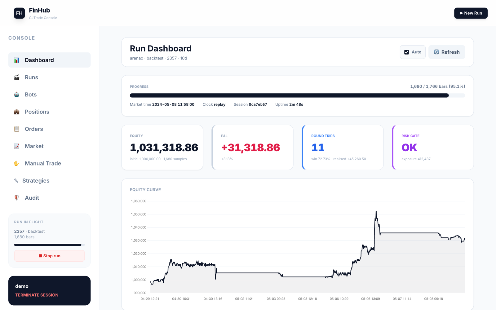

# Run the trading engine

The [oneshot backtest](backtesting.md) is fast but simplified. The trading
engine, `cjtrade`, runs strategies as they run live: minute by minute, on
ArenaX's clock, with real order matching. This page replays a week of
1-minute bars for one stock offline and walks through the report.

## What the engine does

```
 cjtrade (main process)
   ├─ holds the one broker connection and the risk gate
   ├─ every minute: sends each bot the newest closed bar
   ├─ waits until every bot has answered, then steps to the next minute
   └─ bots (one process each, one symbol each)
        Bot_B on 2357  ── buy / sell / hold ──▶ main process ──▶ ArenaX
```

- Each strategy runs as a **bot** in its own process, on one symbol.
- Bots never talk to the broker. They answer the main process, which checks
  each order against the **risk gate** (per-bot capital budget, at most 3
  orders per bar, a stop at a 25% account drawdown) before sending it.
- The engine waits for every bot before advancing, so a replay produces the
  same orders on every run, at any speed.

The set of bots is `BOT_ROSTER` in
[`src/cjtrade/apps/CJTrade/main.py`](https://github.com/jackiesogi/CJTrade/blob/master/src/cjtrade/apps/CJTrade/main.py).
The default is one bot, `Bot_B`, trading `2357` (ASUS) with an ADX regime
strategy. To replace it with your own file, see
[Run your own strategy](#run-your-own-strategy).

## Step 1: download the prices

Fetch three weeks of 1-minute bars for 2357 into a file. This is the only
step that needs the network:

```sh
uv run preload-prices --price-db prices.db --symbols 2357 --start 2026-11-02 --end 2026-11-21 --interval 1m,1d
```

The window must fall within the last 30 days, the limit of Yahoo Finance,
the free minute-bar source.

Expected output:

```text
2357 1m: 3639 bars over 15 days (2026-11-02 09:01 .. 2026-11-20 13:25)
2357 1d: 15 bars over 15 days (2026-11-02 09:00 .. 2026-11-20 09:00)
3654 bars in prices.db
```

## Step 2: start ArenaX on that file

In a separate terminal:

```sh
CJTRADE_OFFLINE=1 AX_INITIAL_BALANCE=1000000 uv run arenaxd --backend=backtest --data=offline --price-db=prices.db
```

| Part | Meaning |
|---|---|
| `CJTRADE_OFFLINE=1` | no network; any download attempt fails |
| `AX_INITIAL_BALANCE=1000000` | simulated account starts with NT$1,000,000 (default 100,000) |
| `--backend=backtest` | replay mode; listens on port **8802**, which the engine expects |
| `--data=offline --price-db=prices.db` | read prices only from the file |

Wait for `sim env started` (about 20 seconds). A preceding
`no fetchable history found in 30 attempts` line is expected: the server
cannot pick a start day on its own and waits for the engine to set it.

## Step 3: run the engine

In a second terminal:

```sh
uv run cjtrade --broker=arenax --mode=backtest --watch-list=2357 --fund=1000000 --days=5 --start-date=2026-11-03 --speed=0
```

| Option | Meaning |
|---|---|
| `--broker=arenax` | trade on ArenaX |
| `--mode=backtest` | connect to the `backtest` server on port 8802 (`demo` is 8801, `paper` 8803) |
| `--watch-list=2357` | symbols to feed; every bot's symbol must be listed |
| `--fund=1000000` | capital the bots size orders against |
| `--days=5` | number of days to replay |
| `--start-date=2026-11-03` | first day; omit for a random day |
| `--speed=0` | unpaced; `60` is one market minute per wall-clock second |

!!! tip "Leave options out to be asked"
    The engine prompts in the terminal for any omitted option, with
    defaults pre-filled, and remembers the answers for the next run.

Expected output (shortened):

```text
[INFO][...] engine: broker=arenax backend=backtest clock=replay symbols=2357 fund=1000000 days=5
[INFO][...] engine.clock: replay: 961 bars, 2026-11-03 09:01:00 .. 2026-11-06 13:25:00, flat out (no pacing)
[INFO][...] engine: spawned Bot_B (bot_b.py, 2357)
[INFO][...] bot.Bot_B: started (2357) strategy=ADX_Adaptive
[INFO][...] engine: @2026-11-03 09:34 FILLED BUY 2357 x218/218 px=915.0 for Bot_B (resolved on refresh) balance=800246
[INFO][...] engine: @2026-11-03 10:04 FILLED SELL 2357 x218/218 px=908.0 for Bot_B (resolved on refresh) balance=997314
...
[INFO][...] engine: replay done: 960 bars in 12.6s (76 bars/s)
==================================================
  Backtest Summary
==================================================
  PnL (Total)  :      -76,768.08  (-7.68%)
  Total fills  : 13
  Max drawdown : -7.21%
  Round trips  : 9  (win 0 / loss 9,  win rate 0.0%)
  ...
[INFO][...] engine.report: result saved: .../reports/engine_be329ab8.pkl
HTML saved -> .../reports/engine_be329ab8.html
```

Notes:

- `replay: 961 bars` is four trading days of 1-minute bars. `--days=5`
  counts calendar days (3 to 7 November), and the 7th is a Saturday.
- `@2026-11-03 09:34` is the event's *market* time; the bracketed field at
  the start of the line is wall-clock time.
- `FILLED BUY 2357 x218/218 px=915.0`: 218 of 218 shares filled at 915.
- The summary has the same lines as the [oneshot report](backtesting.md#read-the-summary).
  This run lost money; the default bot did not suit that week.
- The result is saved as a `.pkl` file and an HTML report; both paths are
  printed.

During a run, status (bots, positions, recent orders) is served at
<http://127.0.0.1:8898/status>.

Stop the ArenaX server with Ctrl+C when done.

## Step 4: look into a run with `insight`

`insight` joins a run's result with the prices for the same period and
writes a diagnostic report:

```sh
uv run insight --list      # every run on this machine
uv run insight             # the most recent one
```

Expected output:

```text
1 run(s) in .../reports:
  be329ab8                                 engine   2026-11-27 15:21     40,893 bytes

Run be329ab8 — 13 fill(s), 9 round trip(s), net -76,768.08
  Sharpe -10.754 · Sortino -10.147 · CAGR -99.81% · max drawdown -7.21%
  report  .../reports/engine_be329ab8.insight.md
  json    .../reports/engine_be329ab8.insight.json
```

The `.insight.md` file has the full write-up. Annualised figures such as
CAGR are not meaningful over a run this short.

## Run your own strategy {#run-your-own-strategy}

To run a strategy file from [Write a strategy](strategy.md) as a bot, list it
in a *roster* file, `roster.json`:

```json
[
  {"bot_id": "Bot_U", "script": "bot_custom.py", "symbol": "2357",
   "extra": ["/absolute/path/to/my_strategy.py"]}
]
```

- `bot_id`: any name; it appears in the logs.
- `script`: `bot_custom.py`, the bot that runs a strategy file.
- `symbol`: the traded stock; it must also be in `--watch-list`.
- `extra`: the **absolute** path of the strategy file.

Then add `--roster=roster.json` to the command in step 3.

## Other modes

| `--mode` | ArenaX started with | Clock |
|---|---|---|
| `backtest` | `uv run arenaxd --backend=backtest` | replays a chosen period, paced by `--speed` |
| `demo` | `uv run arenaxd` | the demo server's own accelerated clock |
| `paper` | `uv run arenaxd --backend=paper` | real clock, during market hours, live Sinopac prices |

The [FinHub web UI](shell-and-finhub.md#finhub) starts ArenaX and the engine
and shows the same run in a browser:



Next: [CJShell and FinHub](shell-and-finhub.md).
