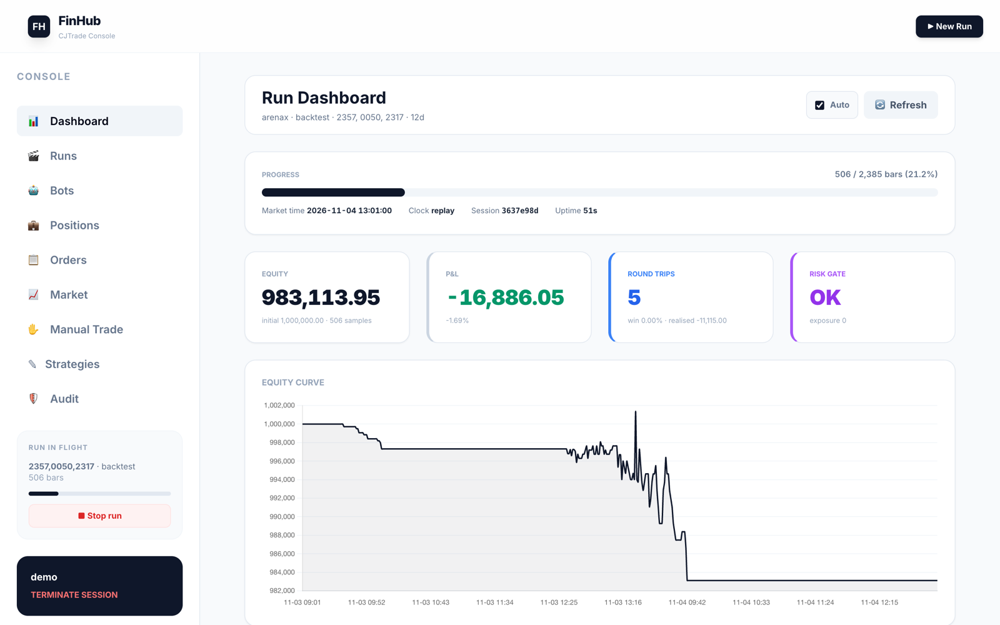

# 執行交易引擎

[一次性回測（oneshot）](backtesting.md)很快，但做了簡化。交易引擎 `cjtrade` 則用接近實盤的方式執行策略：照 ArenaX 的時鐘一分鐘一分鐘地走，並真的撮合委託。這一頁會在離線狀態下，重播一檔股票一週的 1 分 K，然後解讀報告。

## 引擎在做什麼

```
 cjtrade (main process)
   ├─ holds the one broker connection and the risk gate
   ├─ every minute: sends each bot the newest closed bar
   ├─ waits until every bot has answered, then steps to the next minute
   └─ bots (one process each, one symbol each)
        Bot_B on 2357  ── buy / sell / hold ──▶ main process ──▶ ArenaX
```

- 每個策略都以一個 **bot**（機器人）的形式，在自己的 process 裡執行，只負責一檔股票。
- bot 從不直接和券商溝通。它們回答主程式，由主程式拿每筆委託去過**風控閘門**（每個 bot 最多能用多少錢、每根 K 棒最多 3 筆委託、帳戶虧損 25% 就停止），通過了才送出。
- 引擎會等所有 bot 都回答後才往下走。所以不管重播跑多快，每次產生的委託都一樣。

要跑哪些 bot，由 [`src/cjtrade/apps/CJTrade/main.py`](https://github.com/jackiesogi/CJTrade/blob/master/src/cjtrade/apps/CJTrade/main.py) 裡的 `BOT_ROSTER` 決定。預設只有一個 bot `Bot_B`，用 ADX 盤勢切換策略交易 `2357`（華碩）。你可以換成自己的策略檔，見[執行你自己的策略](#run-your-own-strategy)。

## 第 1 步：下載價格

把 2357 三週的 1 分 K 下載到檔案裡。只有這一步會用到網路：

```sh
uv run preload-prices --price-db prices.db --symbols 2357 --start 2026-11-02 --end 2026-11-21 --interval 1m,1d
```

時間區間請選在最近 30 天內：提供分 K 的免費來源 Yahoo Finance，最多只保留這麼久。

預期輸出：

```text
2357 1m: 3639 bars over 15 days (2026-11-02 09:01 .. 2026-11-20 13:25)
2357 1d: 15 bars over 15 days (2026-11-02 09:00 .. 2026-11-20 09:00)
3654 bars in prices.db
```

## 第 2 步：用這個檔案啟動 ArenaX

另外開一個終端機：

```sh
CJTRADE_OFFLINE=1 AX_INITIAL_BALANCE=1000000 uv run arenaxd --backend=backtest --data=offline --price-db=prices.db
```

| 部分 | 意思 |
|---|---|
| `CJTRADE_OFFLINE=1` | 完全不連網；任何需要下載的動作都會直接失敗 |
| `AX_INITIAL_BALANCE=1000000` | 模擬帳戶一開始有 NT$1,000,000（預設是 100,000） |
| `--backend=backtest` | 重播模式；它監聽 port **8802**，也就是引擎預期的 port |
| `--data=offline --price-db=prices.db` | 只從你的檔案讀取價格 |

等它印出 `sim env started`（大約 20 秒）。在那之前出現 `no fetchable history found in 30 attempts` 是正常的：伺服器自己選不出起始日，會等引擎告訴它。

## 第 3 步：執行引擎

在第二個終端機裡：

```sh
uv run cjtrade --broker=arenax --mode=backtest --watch-list=2357 --fund=1000000 --days=5 --start-date=2026-11-03 --speed=0
```

| 選項 | 意思 |
|---|---|
| `--broker=arenax` | 在 ArenaX 上交易 |
| `--mode=backtest` | 連到 port 8802 的 `backtest` 伺服器（`demo` 是 8801，`paper` 是 8803） |
| `--watch-list=2357` | 要餵給 bot 的股票；每個 bot 的股票都必須在這裡面 |
| `--fund=1000000` | bot 計算下單數量時依據的資金 |
| `--days=5` | 要重播幾天 |
| `--start-date=2026-11-03` | 第一天；不填就隨機選一天 |
| `--speed=0` | 越快越好；`60` 代表真實的每一秒走一分鐘的市場時間 |

!!! tip "不填的選項會問你"
    以上任何選項沒填，引擎都會在終端機裡問你，並先填好預設值。你的回答會被記住，下次沿用。

預期輸出（節錄）：

```text
[INFO][...] engine: broker=arenax backend=backtest clock=replay symbols=2357 fund=1000000 days=5
[INFO][...] engine.clock: replay: 961 bars, 2026-11-03 09:01:00 .. 2026-11-06 13:25:00, flat out (no pacing)
[INFO][...] engine: spawned Bot_B (bot_b.py, 2357)
[INFO][...] bot.Bot_B: started (2357) strategy=ADX_Adaptive
[INFO][...] engine: @2026-11-03 09:34 FILLED BUY 2357 x218/218 px=915.0 for Bot_B (resolved on refresh) balance=800246
[INFO][...] engine: @2026-11-03 10:04 FILLED SELL 2357 x218/218 px=908.0 for Bot_B (resolved on refresh) balance=997314
...
[INFO][...] engine: replay done: 960 bars in 12.6s (76 bars/s)
==================================================
  Backtest Summary
==================================================
  PnL (Total)  :      -76,768.08  (-7.68%)
  Total fills  : 13
  Max drawdown : -7.21%
  Round trips  : 9  (win 0 / loss 9,  win rate 0.0%)
  ...
[INFO][...] engine.report: result saved: .../reports/engine_be329ab8.pkl
HTML saved -> .../reports/engine_be329ab8.html
```

怎麼看：

- `replay: 961 bars` 是四個交易日的 1 分 K。`--days=5` 算的是日曆天，也就是 11 月 3 日到 7 日，而 7 日是星期六。
- `@2026-11-03 09:34` 是事件發生的「市場」時間；每行開頭方括號裡的是真實時間。
- `FILLED BUY 2357 x218/218 px=915.0` 代表要買 218 股，218 股全部以 915 成交。
- 摘要的欄位和[一次性回測的報告](backtesting.md#read-the-summary)相同。這次執行是虧錢的：預設的 bot 不適合那一週的行情。回測就是用來發現這種事的。
- 結果會存成一個 `.pkl` 檔和一份 HTML 報告；兩個路徑都會印出來。

執行期間，可以在 <http://127.0.0.1:8898/status> 看到狀態（bot、持股、最近的委託）。

用完後，按 Ctrl+C 停止 ArenaX 伺服器。

## 第 4 步：用 `insight` 深入分析

`insight` 會把一次執行的結果和同一段期間的價格放在一起，寫出一份診斷報告：

```sh
uv run insight --list      # 這台電腦上的所有執行紀錄
uv run insight             # 最近一次
```

預期輸出：

```text
1 run(s) in .../reports:
  be329ab8                                 engine   2026-11-27 15:21     40,893 bytes

Run be329ab8 — 13 fill(s), 9 round trip(s), net -76,768.08
  Sharpe -10.754 · Sortino -10.147 · CAGR -99.81% · max drawdown -7.21%
  report  .../reports/engine_be329ab8.insight.md
  json    .../reports/engine_be329ab8.insight.json
```

完整的分析請打開 `.insight.md` 檔。執行期間這麼短時，CAGR 這類年化數字沒有參考價值。

## 執行你自己的策略 {#run-your-own-strategy}

要把[撰寫策略](strategy.md)裡的策略檔當成 bot 執行，請把它列在名單（roster）檔 `roster.json` 裡：

```json
[
  {"bot_id": "Bot_U", "script": "bot_custom.py", "symbol": "2357",
   "extra": ["/absolute/path/to/my_strategy.py"]}
]
```

- `bot_id` 隨你取名，會出現在 log 裡。
- `script` 填 `bot_custom.py`，也就是負責執行策略檔的 bot。
- `symbol` 是它要交易的股票；也要放進 `--watch-list`。
- `extra` 填策略檔的**絕對**路徑。

然後在第 3 步的指令後面加上 `--roster=roster.json`。

## 其他模式

| `--mode` | ArenaX 的啟動方式 | 時鐘 |
|---|---|---|
| `backtest` | `uv run arenaxd --backend=backtest` | 重播指定的期間，速度由 `--speed` 決定 |
| `demo` | `uv run arenaxd` | demo 伺服器自己的快轉時鐘 |
| `paper` | `uv run arenaxd --backend=paper` | 真實時鐘，在交易時段內，使用 Sinopac 的即時價格 |

[FinHub 網頁介面](shell-and-finhub.md#finhub)會幫你啟動 ArenaX 和引擎，並在瀏覽器裡顯示同樣的執行過程：



下一步：[CJShell 和 FinHub](shell-and-finhub.md)。
