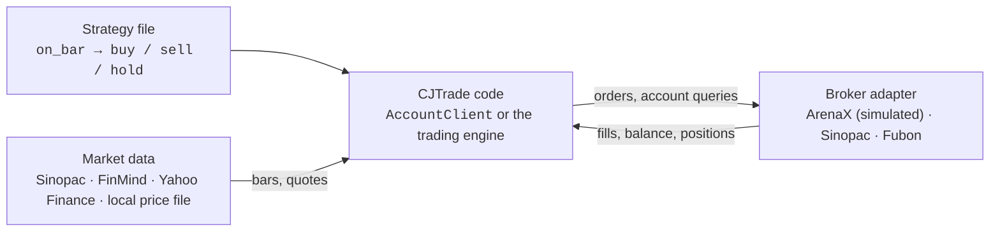

# CJTrade

CJTrade is a Python framework for trading stocks on the Taiwan Stock Exchange
(TWSE). A strategy is a single Python file, and the same file runs unchanged
in three modes:

1. **Backtest**: replayed over historical prices.
2. **Paper trading**: against ArenaX, a simulated broker that runs locally,
   with no money at risk.
3. **Live**: against a real brokerage account. Sinopac (永豐金證券) and
   Fubon (富邦證券) are supported; the broker is one argument, so moving
   between them changes no strategy code.

No brokerage account is required for any of
[Get started](get-started/install.md); it runs locally on free price data.

!!! danger "Not investment advice"
    CJTrade can place real orders on a real account, and you are responsible
    for every order it sends. Run a strategy on ArenaX first, then with
    small orders on a live account (Sinopac offers a sandbox), before it
    trades real size.

## Architecture

- **Broker**: receives orders and holds cash and positions. **ArenaX** is the
  simulated broker bundled with CJTrade: a local server that accepts orders
  and fills them against real historical prices.
- **Market data**: the price source, independent of the broker. You can, for
  example, trade on ArenaX with prices from Yahoo Finance.
- **`AccountClient`**: the single object your code uses to talk to a broker.
  Each broker sits behind an adapter that converts CJTrade's orders,
  statuses and positions to its SDK, so the same calls work on ArenaX,
  Sinopac and Fubon. See [Live brokers](get-started/live-brokers.md).

[Key ideas](get-started/concepts.md) defines CJTrade's terms and conventions.

## Choose your path

| Goal | Start here | Time |
|---|---|---|
| Install CJTrade and verify the install | [Install](get-started/install.md) | 5 min |
| CJTrade terms and conventions | [Key ideas](get-started/concepts.md) | 10 min |
| Place a first order on ArenaX from Python | [Connect to a broker](get-started/connect.md), then [Account and orders](get-started/account-and-orders.md) | 15 min |
| Connect a Sinopac or Fubon account | [Live brokers](get-started/live-brokers.md) | 10 min |
| Fetch prices and compute an indicator | [Market data](get-started/market-data.md) | 10 min |
| Write a strategy and backtest it over a year | [Write a strategy](get-started/strategy.md), then [Backtesting](get-started/backtesting.md) | 20 min |
| Run several bots minute by minute, as in live trading | [Run the trading engine](get-started/trading-engine.md) | 15 min |
| Use the interactive shell or the web UI | [CJShell and FinHub](get-started/shell-and-finhub.md) | 10 min |
| Fix an error | [Troubleshooting](get-started/troubleshooting.md) | |

Each Get started page builds on the previous one; read them in order the
first time.

## Lookup

| Look up | Page |
|---|---|
| Every command, its options and ports | [Commands](reference/commands.md) |
| Settings files and environment variables | [Configuration and paths](reference/config.md) |
| A class or function | [API reference](reference/index.md) |

!!! note
    The API is not stable yet; names may change before 1.0.
