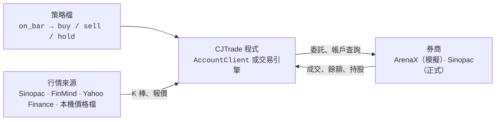

# CJTrade

CJTrade 是用來交易台灣證券交易所（TWSE）股票的 Python 框架。策略是一個 Python 檔，同一個檔案不需修改即可在三種模式下執行：

1. **回測**：用歷史價格重播。
2. **模擬交易**：在本機執行的模擬券商 ArenaX 上交易，不動用資金。
3. **實盤**：在永豐金證券（Sinopac）帳戶上交易。

[開始使用](get-started/install.md)的所有內容都不需要券商帳戶，只用免費的價格資料在本機執行。

!!! danger "這不是投資建議"
    CJTrade 可以在正式帳戶上送出真實委託，它送出的每一筆委託都由你負責。策略請先在 ArenaX 上執行，再到 Sinopac 的沙盒（模擬環境）驗證，之後才動用真實資金。

## 架構

- **券商**：接收委託，保管現金與持股。**ArenaX** 是 CJTrade 內建的模擬券商：在本機執行的伺服器，接收委託並以真實歷史價格撮合成交。
- **行情來源**：價格的來源，與券商互相獨立。例如可以在 ArenaX 上交易，同時使用 Yahoo Finance 的價格。
- **`AccountClient`**：程式與券商溝通的唯一物件。同樣的呼叫在 ArenaX 和 Sinopac 上都適用。

CJTrade 的用語與慣例定義在[基本概念](get-started/concepts.md)。

## 選擇你的路線

| 目標 | 從這裡開始 | 時間 |
|---|---|---|
| 安裝 CJTrade 並驗證安裝 | [安裝](get-started/install.md) | 5 分鐘 |
| CJTrade 的用語與慣例 | [基本概念](get-started/concepts.md) | 10 分鐘 |
| 用 Python 在 ArenaX 上下第一筆委託 | [連線到券商](get-started/connect.md)，接著看[帳戶與委託](get-started/account-and-orders.md) | 15 分鐘 |
| 取得價格並計算技術指標 | [行情資料](get-started/market-data.md) | 10 分鐘 |
| 撰寫策略，用一年的價格回測 | [撰寫策略](get-started/strategy.md)，接著看[回測](get-started/backtesting.md) | 20 分鐘 |
| 以實盤的方式逐分鐘執行多個 bot | [執行交易引擎](get-started/trading-engine.md) | 15 分鐘 |
| 使用互動式 shell 或網頁介面 | [CJShell 與 FinHub](get-started/shell-and-finhub.md) | 10 分鐘 |
| 排除錯誤 | [疑難排解](get-started/troubleshooting.md) | |

「開始使用」各頁內容前後銜接，第一次閱讀請依序進行。

## 查詢

| 要查 | 頁面 |
|---|---|
| 所有指令、選項和連接埠 | [指令](reference/commands.md) |
| 設定檔和環境變數 | [設定與路徑](reference/config.md) |
| 某個類別或函式 | [API 參考](reference/index.md) |

!!! note
    API 尚未穩定，1.0 之前名稱可能變動。
