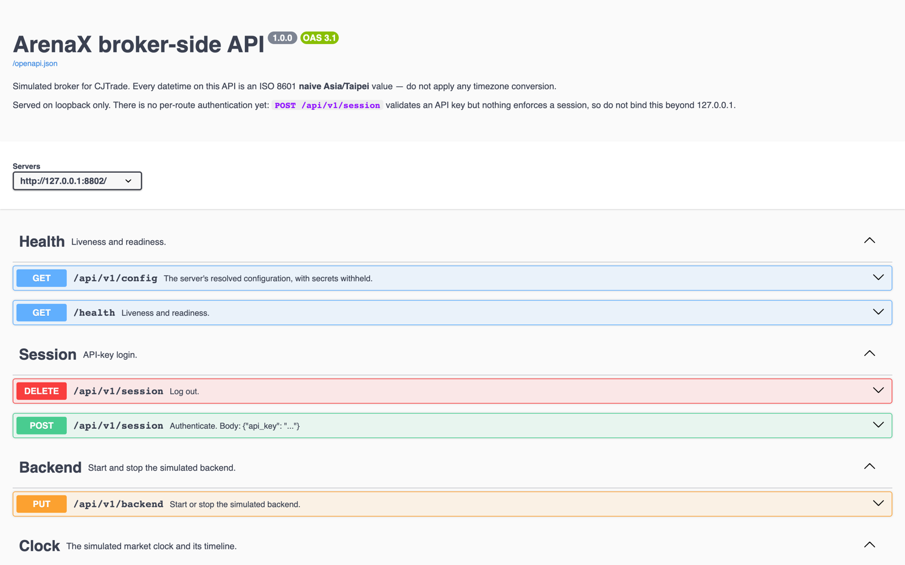

# Commands

Every command CJTrade installs, with its purpose and options. In a source
checkout, prefix each with `uv run` (`uv run arenaxd`); after
`pip install cjtrade`, run them without the prefix.

| Command | What it is | Needs a broker account? | Ports |
|---|---|---|---|
| [`arenaxd`](#arenaxd) | the ArenaX pretend-broker server | only for the `sinopac` price source, `paper` and `real` | 8801 / 8802 / 8803 / 8888 |
| [`cjtrade`](#cjtrade) | the trading engine (bots, risk gate, replay clock) | no, on ArenaX | uses ArenaX's port; status 8898; internal 5555, 5556 |
| [`preload-prices`](#preload-prices) | download bars into a price file | no (FinMind, Yahoo) | |
| [`insight`](#insight) | diagnostic report for a finished run | no | |
| [`strategy-tool`](#strategy-tool) | templates, checks and the vocabulary for strategy files | no | |
| [`backtest`](#backtest) | oneshot backtest of a built-in strategy from the command line | no, on ArenaX | uses ArenaX's port |
| [`cjshell`](#cjshell) | interactive command line for an account | Sinopac, Fubon and Yuanta only | uses ArenaX's port |
| [`finhub`](#finhub) | web UI for the trading engine | no | 8000 |
| `aresh` | admin shell for a running ArenaX server | no | uses ArenaX's port |

Every server binds to `127.0.0.1` only and is not reachable from other
machines.

## `arenaxd` {#arenaxd}

Starts the ArenaX server: one simulated account, orders accepted over HTTP
and filled against prices from the configured data source on a simulated
clock.

```sh
arenaxd [--backend=demo|backtest|paper|real] [--port=N] [--data=SOURCES] [--price-db=FILE]
```

| Option | Default | Meaning |
|---|---|---|
| `--backend` | `demo` | which mode to run; see the table below |
| `--port` | per backend | the port to listen on |
| `--host` | `127.0.0.1` | only loopback addresses are accepted |
| `--data` | per backend | price sources in order, comma-separated: `sinopac`, `finmind`, `yfinance`, `cache`, `offline` |
| `--price-db` | the shared price cache | the SQLite price file to read and fill |

| Backend | Port | Default `--data` | Clock | Orders |
|---|---|---|---|---|
| `demo` | 8801 | `yfinance` | starts 11-20 days back, 120× speed | ArenaX |
| `backtest` | 8802 | `sinopac,yfinance` | starts where the client says | ArenaX |
| `paper` | 8803 | `sinopac` | real time | ArenaX |
| `real` | 8888 | `sinopac` | real time | **real Sinopac account**; refuses to start without `I_UNDERSTAND_REAL_TRADING_RISKS=y` |

While it runs, `http://127.0.0.1:<port>/docs` documents every endpoint and
lets you call it:



Other backend settings are the `AX_*` keys in
[Configuration and paths](config.md#arenax-server-settings).

## `cjtrade` {#cjtrade}

Runs the bots in `BOT_ROSTER` (or a roster file) against ArenaX, bar by bar.
Omitted options are prompted for interactively. See
[Run the trading engine](../get-started/trading-engine.md).

| Option | Default | Meaning |
|---|---|---|
| `--broker` | `arenax` | the engine runs on ArenaX |
| `--mode` | `backtest` | `backtest`, `demo` or `paper`; picks ArenaX's port 8802, 8801 or 8803 |
| `--watch-list` | | symbols to feed, comma-separated; must include every bot's symbol |
| `--fund` | 500000 | money the bots size orders against |
| `--days` | 365 | calendar days to replay |
| `--start-date` | random | first day, `YYYY-MM-DD` |
| `--speed` | 1200 | market seconds per real second; `0` is as fast as possible; ignored in `paper` |
| `--roster=FILE` | `BOT_ROSTER` | a JSON list of `{"bot_id", "script", "symbol", "extra"}` |

Writes `engine_<session>.pkl` (the result), `.html` (the report) and
`.equity.jsonl` to the reports folder. Status page while running:
<http://127.0.0.1:8898/status>.

## `preload-prices` {#preload-prices}

Downloads bars into a price file for offline ArenaX runs. Only windows
missing from the file are fetched.

| Option | Default | Meaning |
|---|---|---|
| `--symbols` | required | comma-separated |
| `--start` | required | first day, `YYYY-MM-DD` |
| `--end` | tomorrow | day to stop before |
| `--interval` | `1m,5m,1h,1d` | bar sizes |
| `--data` | `finmind,yfinance` | sources in order; `sinopac` needs an account |
| `--price-db` | the shared price cache | the file to fill |

## `insight` {#insight}

Joins a finished run with the prices of the same window and writes a
Markdown and a JSON report next to the run.

| Option | Meaning |
|---|---|
| `RUN` | a session id, a unique prefix of one, or a path to an `engine_*.pkl`; default the latest |
| `--list` | list every run on this machine |
| `--out DIR` | write the reports here |
| `--stdout` | also print the Markdown report |

## `strategy-tool` {#strategy-tool}

Every subcommand prints JSON.

| Subcommand | Does |
|---|---|
| `templates` | list the template kinds |
| `template --kind bb|dca|adx|blank [--name NAME] [--symbol SYMBOL]` | a complete starter strategy, in the `source` field |
| `check [--file FILE]` | diagnostics and declared parameters for a strategy file (stdin by default) |
| `api` | every name a strategy file may use |

## `backtest` {#backtest}

Oneshot backtester for built-in strategies. Fetches bars from a running
ArenaX server.

| Option | Default | Meaning |
|---|---|---|
| `--symbol` | required | one or more, comma-separated |
| `--start` | random | first day |
| `--duration` | 365 | days |
| `--interval` | `1d` | `1m`, `5m`, `1h` or `1d` |
| `--balance` | 1000000 | starting cash |
| `--strategy` | `BollingerStrategy` | `BollingerStrategy`, `SupportResistanceStrategy`, `DCA_Monthly`, `DonchianBreakoutStrategy`, `ADXAdaptiveStrategy`, `BaselineStrategy` |
| `--params` | | overrides, `key1:val1,key2:val2`, e.g. `bb__window_size:30` |
| `--show-params` | | print the strategy's parameters and exit |
| `--compare` | | compare several strategies |
| `--no-browser` | | do not open the HTML report |

## `cjshell` {#cjshell}

```sh
cjshell --broker=arenax|sinopac|fubon|yuanta [COMMAND [ARGS...]]
```

With a command, runs it once and exits; without, opens a prompt. Reads
the `*.cjconf` settings files (create them with
`bash scripts/gen_config.sh arenax|sinopac|fubon|yuanta`). `help` lists every command;
the common ones are in [CJShell and FinHub](../get-started/shell-and-finhub.md#cjshell).

## `finhub` {#finhub}

| Option | Default | Meaning |
|---|---|---|
| `--port` | 8000 | port on 127.0.0.1 |
| `--reload` | | restart when the code changes (development) |

Settings are `FINHUB_*` environment variables; see the
[FinHub README](https://github.com/jackiesogi/CJTrade/blob/master/src/cjtrade/apps/FinHub/README.md).

## Scripts in a source checkout

| Script | Does |
|---|---|
| `bash scripts/gen_config.sh arenax|sinopac|fubon|yuanta` | writes a settings file for CJShell |
| `bash poc/backtest.sh` | the oneshot backtester driven by a form; starts `arenaxd` if needed |
| `bash tests/run_broker_stability_tests.sh --broker=arenax` | ArenaX integration tests |
| `uv run pytest tests/unit` | unit tests |

The developer notes in
[`ref/TOOLS.md`](https://github.com/jackiesogi/CJTrade/blob/master/ref/TOOLS.md)
(Chinese) cover every entry point in more detail.
