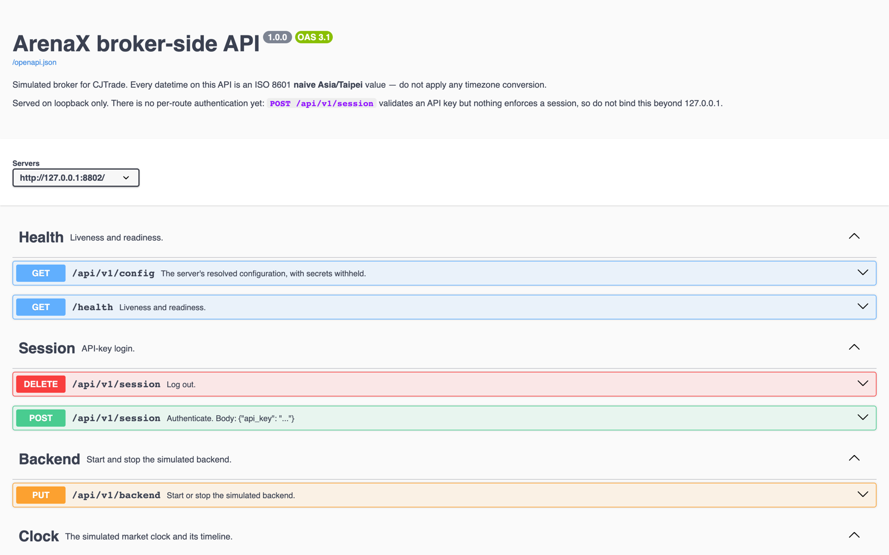

# 指令

CJTrade 安裝的所有指令、各自的用途和選項。從原始碼執行時，在每個指令前面加上
`uv run`（`uv run arenaxd`）；用 `pip install cjtrade` 安裝後，可以直接執行。

| 指令 | 用途 | 需要券商帳戶嗎？ | 埠（port） |
|---|---|---|---|
| [`arenaxd`](#arenaxd) | ArenaX 模擬券商伺服器 | 只有 `sinopac` 價格來源、`paper` 和 `real` 需要 | 8801 / 8802 / 8803 / 8888 |
| [`cjtrade`](#cjtrade) | 交易引擎（bot、風控閘門、重播時鐘） | 不需要，在 ArenaX 上執行 | 使用 ArenaX 的埠；狀態頁 8898；內部 5555、5556 |
| [`preload-prices`](#preload-prices) | 把 K 棒下載到價格檔 | 不需要（FinMind、Yahoo） | |
| [`insight`](#insight) | 針對已完成的執行產生診斷報告 | 不需要 | |
| [`strategy-tool`](#strategy-tool) | 策略檔的範本、檢查和可用詞彙 | 不需要 | |
| [`backtest`](#backtest) | 從命令列對內建策略做一次性回測（oneshot） | 不需要，在 ArenaX 上執行 | 使用 ArenaX 的埠 |
| [`cjshell`](#cjshell) | 操作帳戶的互動式命令列 | 只有 Sinopac 需要 | 使用 ArenaX 的埠 |
| [`finhub`](#finhub) | 交易引擎的網頁介面 | 不需要 | 8000 |
| `aresh` | 管理執行中 ArenaX 伺服器的 shell | 不需要 | 使用 ArenaX 的埠 |

所有伺服器都只綁定 `127.0.0.1`，其他機器無法連到。

## `arenaxd` {#arenaxd}

啟動 ArenaX 伺服器。它維護一個模擬帳戶，透過 HTTP 接收委託，並在模擬時鐘上用資料
來源的價格撮合成交。

```sh
arenaxd [--backend=demo|backtest|paper|real] [--port=N] [--data=SOURCES] [--price-db=FILE]
```

| 選項 | 預設值 | 說明 |
|---|---|---|
| `--backend` | `demo` | 要執行的模式；見下表 |
| `--port` | 依 backend 而定 | 要監聽的埠 |
| `--host` | `127.0.0.1` | 只接受本機（127.0.0.1）位址 |
| `--data` | 依 backend 而定 | 價格來源，依序以逗號分隔：`sinopac`、`finmind`、`yfinance`、`cache`、`offline` |
| `--price-db` | 共用的價格快取 | 要讀取並補齊的 SQLite 價格檔 |

| Backend | 埠 | 預設 `--data` | 時鐘 | 委託 |
|---|---|---|---|---|
| `demo` | 8801 | `yfinance` | 從 11-20 天前開始，120 倍速 | ArenaX |
| `backtest` | 8802 | `sinopac,yfinance` | 從用戶端指定的時間開始 | ArenaX |
| `paper` | 8803 | `sinopac` | 實際時間 | ArenaX |
| `real` | 8888 | `sinopac` | 實際時間 | **Sinopac 正式帳戶**；沒有設定 `I_UNDERSTAND_REAL_TRADING_RISKS=y` 就拒絕啟動 |

執行時，可以在 `http://127.0.0.1:<port>/docs` 查看每個 API 端點的說明，也能直接試用：



backend 的其他設定是[設定與路徑](config.md#arenax-server-settings)中的 `AX_*` 鍵。

## `cjtrade` {#cjtrade}

在 ArenaX 上逐根 K 棒執行 `BOT_ROSTER`（或名單（roster）檔）裡的 bot。沒有給的選項
會在終端機中詢問。見[執行交易引擎](../get-started/trading-engine.md)。

| 選項 | 預設值 | 說明 |
|---|---|---|
| `--broker` | `arenax` | 交易引擎在 ArenaX 上執行 |
| `--mode` | `backtest` | `backtest`、`demo` 或 `paper`；分別對應 ArenaX 的埠 8802、8801 或 8803 |
| `--watch-list` | | 要餵入的股票代號，以逗號分隔；必須包含每個 bot 的股票代號 |
| `--fund` | 500000 | bot 計算委託數量時依據的資金 |
| `--days` | 365 | 要重播的日曆天數 |
| `--start-date` | 隨機 | 第一天，`YYYY-MM-DD` |
| `--speed` | 1200 | 每實際一秒前進的市場秒數；`0` 代表越快越好；`paper` 模式會忽略 |
| `--roster=FILE` | `BOT_ROSTER` | `{"bot_id", "script", "symbol", "extra"}` 組成的 JSON list |

會在報告資料夾寫出 `engine_<session>.pkl`（結果）、`.html`（報告）和
`.equity.jsonl`。執行期間的狀態頁：
<http://127.0.0.1:8898/status>。

## `preload-prices` {#preload-prices}

把 K 棒下載到價格檔，讓 ArenaX 可以離線使用。只會下載檔案裡缺少的區間。

| 選項 | 預設值 | 說明 |
|---|---|---|
| `--symbols` | 必填 | 以逗號分隔 |
| `--start` | 必填 | 第一天，`YYYY-MM-DD` |
| `--end` | 明天 | 結束日（不含當天） |
| `--interval` | `1m,5m,1h,1d` | K 棒週期 |
| `--data` | `finmind,yfinance` | 依序使用的來源；`sinopac` 需要帳戶 |
| `--price-db` | 共用的價格快取 | 要補齊的檔案 |

## `insight` {#insight}

把已完成的執行和同一區間的價格結合，在該次執行旁邊寫出 Markdown 和 JSON 報告。

| 選項 | 說明 |
|---|---|
| `RUN` | session id、能唯一辨識的 id 前綴，或 `engine_*.pkl` 的路徑；預設為最近一次 |
| `--list` | 列出這台電腦上的所有執行 |
| `--out DIR` | 把報告寫到這個資料夾 |
| `--stdout` | 同時印出 Markdown 報告 |

## `strategy-tool` {#strategy-tool}

每個子指令都輸出 JSON。

| 子指令 | 作用 |
|---|---|
| `templates` | 列出範本種類 |
| `template --kind bb|dca|adx|blank [--name NAME] [--symbol SYMBOL]` | 完整的入門策略，放在 `source` 欄位 |
| `check [--file FILE]` | 策略檔的診斷結果和宣告的參數（預設讀 stdin） |
| `api` | 策略檔可以使用的所有名稱 |

## `backtest` {#backtest}

內建策略的一次性回測（oneshot）工具。它從執行中的 ArenaX 伺服器取得 K 棒。

| 選項 | 預設值 | 說明 |
|---|---|---|
| `--symbol` | 必填 | 一個或多個，以逗號分隔 |
| `--start` | 隨機 | 第一天 |
| `--duration` | 365 | 天數 |
| `--interval` | `1d` | `1m`、`5m`、`1h` 或 `1d` |
| `--balance` | 1000000 | 起始現金 |
| `--strategy` | `BollingerStrategy` | `BollingerStrategy`、`SupportResistanceStrategy`、`DCA_Monthly`、`DonchianBreakoutStrategy`、`ADXAdaptiveStrategy`、`BaselineStrategy` |
| `--params` | | 覆寫參數，`key1:val1,key2:val2`，例如 `bb__window_size:30` |
| `--show-params` | | 印出策略的參數後結束 |
| `--compare` | | 比較多個策略 |
| `--no-browser` | | 不開啟 HTML 報告 |

## `cjshell` {#cjshell}

```sh
cjshell --broker=arenax|sinopac [COMMAND [ARGS...]]
```

有給指令時，執行一次就結束；沒有給則開啟提示字元。讀取
`arenax_system.cjconf` 或 `sinopac_system.cjconf`（用
`bash scripts/gen_config.sh arenax|sinopac` 建立）。`help` 會列出所有指令；
常用指令見 [CJShell 與 FinHub](../get-started/shell-and-finhub.md#cjshell)。

## `finhub` {#finhub}

| 選項 | 預設值 | 說明 |
|---|---|---|
| `--port` | 8000 | 127.0.0.1 上的埠 |
| `--reload` | | 程式碼變更時自動重新啟動（開發用） |

設定是 `FINHUB_*` 環境變數；見
[FinHub README](https://github.com/jackiesogi/CJTrade/blob/master/src/cjtrade/apps/FinHub/README.md)。

## 原始碼中的腳本

| 腳本 | 作用 |
|---|---|
| `bash scripts/gen_config.sh arenax|sinopac` | 為 CJShell 寫出設定檔 |
| `bash poc/backtest.sh` | 以表單操作的一次性回測（oneshot）工具；必要時會啟動 `arenaxd` |
| `bash tests/run_broker_stability_tests.sh --broker=arenax` | ArenaX 整合測試 |
| `uv run pytest tests/unit` | 單元測試 |

開發者筆記
[`ref/TOOLS.md`](https://github.com/jackiesogi/CJTrade/blob/master/ref/TOOLS.md)
（中文）對每個進入點有更詳細的說明。
