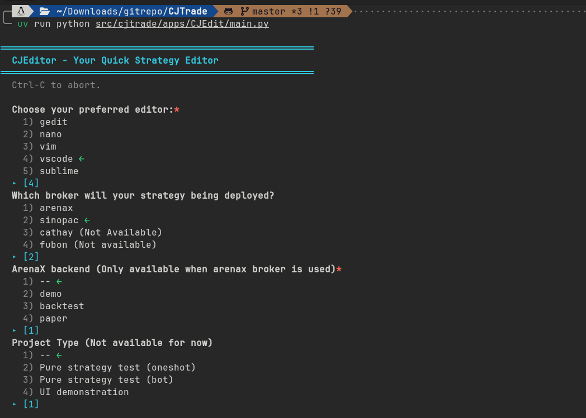
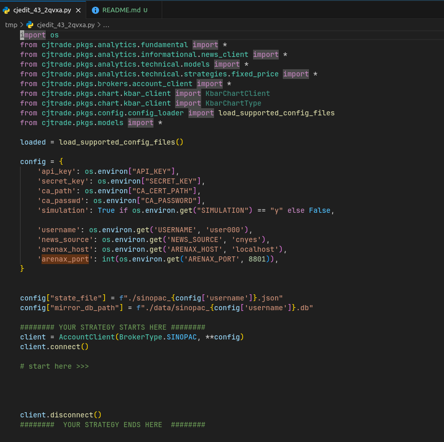

# CJEdit

> A simple editing tool for quick strategy testing.

<!-- cjcheck: smoke timeout=12 -->
```sh
uv run python src/cjtrade/apps/CJEdit/main.py
```

It asks in the terminal which editor and broker you want, writes the matching
imports into a scratch file, and opens that file in the editor you chose
(gedit, nano, vim, VS Code or Sublime Text). When you are done it prints the
command that runs what you wrote, so the file outlives the session and can be
kept if it turns out to be worth keeping. The broker defaults to ArenaX,
which needs no credentials; Sinopac needs the four keys in a `.cjconf`.

Intended for trying an idea out in a couple of minutes. A strategy you mean to
backtest belongs in a file written against
`cjtrade.pkgs.strategy.authoring`, which the trading engine can run directly.




