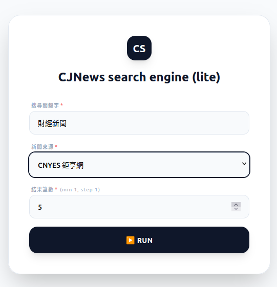
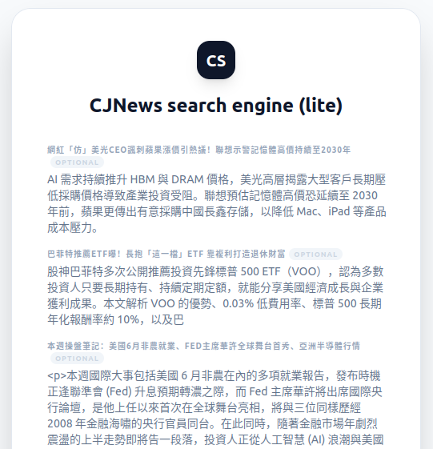

# CJNews

> A financial news search engine built with the CJTrade SDK.

72 lines of code, which is the point of it: the news providers and the form
rendering both come from the SDK, so the app is only the part that is specific
to searching news.

```sh
uv run python src/cjtrade/apps/CJNews/main.py
```

It asks for a keyword, a source and how many results you want, then opens the
results in your browser. Searching for nothing in particular falls back to the
headlines. Sources currently wired up: CNYES (鉅亨網) and NewsAPI.

## Packages used

- `cjtrade.pkgs.ui`: renders a web form from a TOML description.
- `cjtrade.pkgs.analytics`: bridges the different news sources behind one
  `NewsClient`.

## Demo

- Search engine interface

    

- Search result

    
