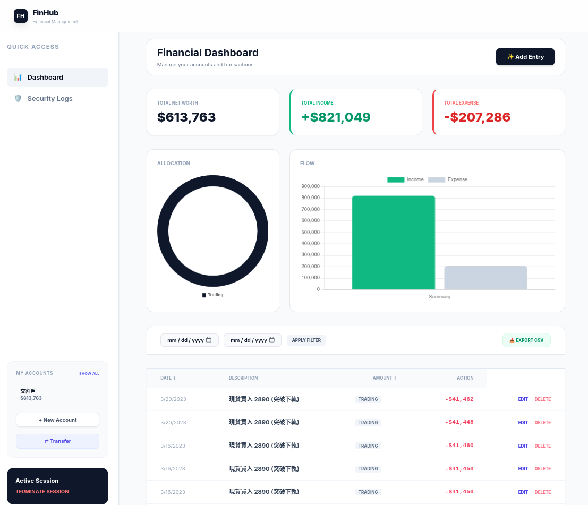

# FinHub



The web UI for the CJTrade app. Start a backtest, watch the bots while they
run, and trade by hand.

## Run it

FinHub needs the `finhub` extra, which a checkout's `uv sync` already installs:

<!-- cjcheck: static -->
```sh
uv run finhub                 # http://127.0.0.1:8000
uv run finhub --port 8010     # another port, still on 127.0.0.1
pip install "cjtrade[finhub]" && finhub   # outside a checkout
```

Open <http://127.0.0.1:8000>, register an account, sign in. FinHub starts
the ArenaX broker and the engine itself, from the same Python it runs in, so
nothing else needs to be running first.

It only ever listens on `127.0.0.1`; there is no option to widen that (see
"Why loopback" below). To use it from another machine, forward the port:
`ssh -L 8000:127.0.0.1:8000 <host>`.

### Settings

Every setting is an environment variable with a `FINHUB_` prefix, or a line in
`finhub.env` in the cjtrade config directory (`paths.config_dir()`). None is
required.

| Variable | Default | What it is |
|---|---|---|
| `FINHUB_SECRET_KEY` | random per process | Signs session tokens. Unset, everyone is logged out when FinHub restarts. Generate one with `python -c 'import secrets; print(secrets.token_urlsafe(48))'` |
| `FINHUB_DATABASE_URL` | `<data dir>/finhub/finhub.db` | Where accounts and run records live |
| `FINHUB_ENGINE_STATUS_PORT` | `8898` | The engine's read-only status API |
| `FINHUB_ARENAX_PORT` | `8802` | The ArenaX server a run uses (the backtest instance) |
| `FINHUB_ARENAX_API_KEY` | `testkey123` | The key FinHub opens its broker session with |

Run logs and each run's copy of its strategy files go to
`<data dir>/finhub/`. A run's broker reads its prices as `arenaxd` does, so
`AX_DATA_SOURCES=offline AX_PRICE_DB_PATH=<file> uv run finhub` replays on a
preloaded price file with no network.

## How the pieces fit

<!-- cjcheck: skip reason="a diagram" -->
```
   browser
      │  only ever talks to FinHub
      ▼
   FinHub  :8000
      ├── HTTP ──▶  engine status API   127.0.0.1:8898   (GET only)
      ├── HTTP ──▶  ArenaX broker       127.0.0.1:8802   (account, orders, market)
      └── spawn ─▶  arenaxd  +  cjtrade  →  bot subprocesses
```

Three sources, each the only one that can answer its own questions:

| Source | Answers | Why not somewhere else |
|---|---|---|
| engine `:8898` | what the bots are doing right now | the engine is the only process that talks to every bot |
| broker `:8802` | the account, the orders, the market | the broker is the authority on the account; it also applies the cost model, so commission and tax exist only here |
| FinHub's own DB | that a run happened, who placed what by hand | the engine forgets a run when its process exits, and the broker never knew who asked |

### The browser never talks to CJTrade

This used to be the other way round: `static/cjtrade_extension.js` fetched
`http://localhost:8899` straight from the page. Every call now goes through
FinHub, server-side, which buys three things.

1. **CORS stops being a question.** The engine and the broker can stay on
   loopback with no `Access-Control-Allow-Origin` header at all. A wildcard
   there would let any page the user happens to have open read their balance
   and positions, and a loopback bind does nothing about that — the request
   comes from the user's own browser.
2. **One place knows the contract.** When ArenaX renames a field, one Python
   module breaks instead of three JS files.
3. **The API key stays server-side.** Placing an order needs it; the browser
   must not have it.

### Why loopback

Both CJTrade APIs serve account data and neither authenticates per route — the
ArenaX server's own description says so, and the engine's status API is private
by binding rather than by a credential. FinHub holds a session token, so it is
the one piece of this stack that *is* authenticated, and even it defaults to
`127.0.0.1`. If you need to reach FinHub from another machine, use an SSH local
port-forward rather than a wider bind.

## Pages, and the shell command each one replaces

`cjtrade` shell has 21 commands. The ones that are about trading all have a
home here:

| Shell | FinHub | Notes |
|---|---|---|
| `balance` | Positions | cash, shown with market value and cost |
| `lspos` | Positions | red = gain, green = loss, as the shell does it |
| `lsodr` | Orders | sorted newest first |
| `buy` / `sell` | Manual Trade | limit ROD on TSE, odd or common lot — the same fields the shell sends |
| `cancel` | Orders → Cancel all | asks first, and reports per order rather than a count |
| `ohlcv` | Market → Snapshot | several symbols at once |
| `kbars` | Market → Historical bars | with real start/end/interval, which the shell hardcodes |
| `replay` | Market → Historical bars | the chart, without writing an HTML file and opening a tab |
| `date` | Market → Simulated clock | market time, timeline origin, playback speed, paused |
| `info` | the Engine/Broker lamps in the header | |
| `start` | Runs → New Run | a real strategy under the engine, not the shell's fixed-price loop |

Not carried over, and why:

- **`system`** — runs an arbitrary OS command through a shell. That is remote
  code execution the moment it is behind a web route. Deliberately absent.
- **`llm`, `news`, `search`** — they talk to OpenAI and news providers, not to
  the broker. Worth having; a different job from this one.
- **`bidask`** — the ArenaX server does not have real depth; the broker adapter
  *synthesises* five levels from the close ± 0.5 with random volumes. Showing
  that in a UI would look like market data and would not be.
- **`rank`** — `get_market_movers` returns `None` on ArenaX. Nothing to show.
- **`help`, `clear`, `exit`** — shell furniture.

FinHub also shows things the shell cannot:

- **Runs** — every run, its configuration, how it ended, and its captured log.
- **Bots** — a card per bot with its uptime, bar, cash, dropped bars, in-flight
  orders, and whatever its strategy chose to expose through `monitors()`. Click
  one for the full monitor set, a chart of its bands, and the per-bar
  `last_decision` trail. Built for N bots from the start; the engine spawns one
  today.
- **Risk gate** — halted or not, and the reason, which otherwise only appears
  in the engine's log.

## Manual trading, honestly

A manual order goes straight to the broker. **The engine's risk gate never
sees it.** The per-bot allocation, the orders-per-bar limit, the duplicate
check and the kill switch do not apply.

What does still apply: the broker checks price, quantity, trading limit,
balance and inventory, and refuses with a reason. A refusal comes back as a
`REJECTED` status, not an error, so read the status.

And a running bot will not know it happened — a bot's ledger mirror is built
from the engine's order reports, so a manual fill moves the real balance
underneath a bot that still thinks it knows its own cash. That is why the form
has an acknowledgement, why every manual order is tagged
`opt_field.source = "finhub-manual"` in the broker's fill history, and why
there is a separate table for them on the Orders page.

Routing a manual order *through* the engine, so the risk gate sees it, needs a
write endpoint on the engine's status API. That API is GET-only on purpose, so
this is a decision rather than an oversight.

## Known limits

- **One run at a time.** Not a simplification: the engine binds fixed ZMQ ports
  (5555 for the price feed, 5556 for order intents), so a second engine would
  either fail to bind or have its bots subscribe to the first engine's bars.
  `protocol.py` parameterises the ports but `cjtrade` passes the defaults.
- **One bar is one minute.** The engine replays 1m bars, so the run form
  offers only `1m`.
- **Fresh state is per server process, not per run.** `AX_STATE_FILE` is
  commented out in every `.cjsys`, so a server that is reused across two runs
  gives the second run the first one's leftover balance. FinHub reuses a broker
  it finds already listening — that is usually what you want for a quick second
  run, and it is why the Runs page shows the balance the engine actually got
  rather than the fund you asked for.
- **No Docker image.** FinHub is the supervisor: it runs the broker and the
  engine as child processes of its own Python. The piece worth an image is
  `arenaxd` — a service with a port and no credentials. Publishing it needs
  `127.0.0.1:8801:8801`; a bare `8801:8801` publishes on every interface and
  undoes the loopback posture above.

## Development

<!-- cjcheck: static -->
```sh
uv run pytest tests/unit/apps/FinHub -q    # no engine or broker needed
```

The tests fake both upstreams, so they do not need a running CJTrade. What
they cannot cover is the contract itself — that the broker still wants
`order_lot: "IntraDayOdd"` and `type: "Stocks"` — so `clients/arenax_client.py`
spells those out in one place with the reason next to them.
