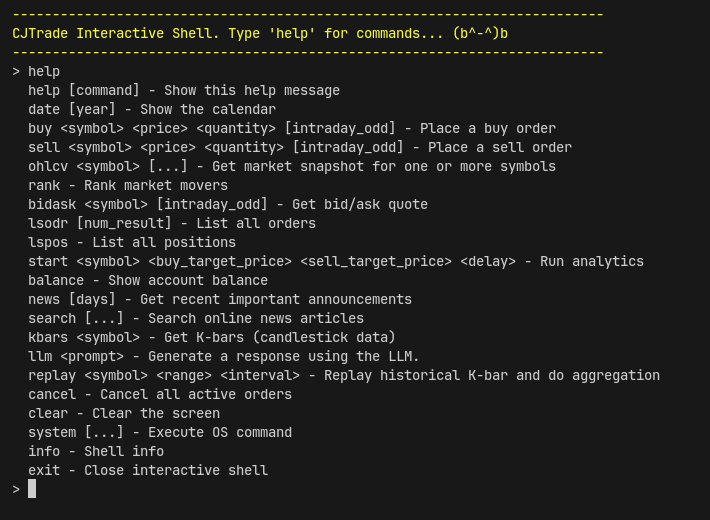
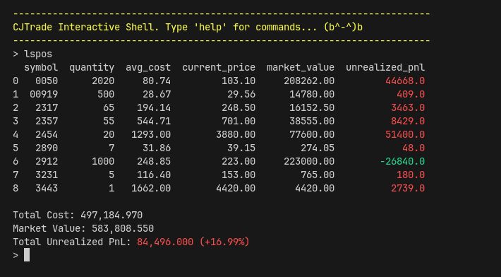
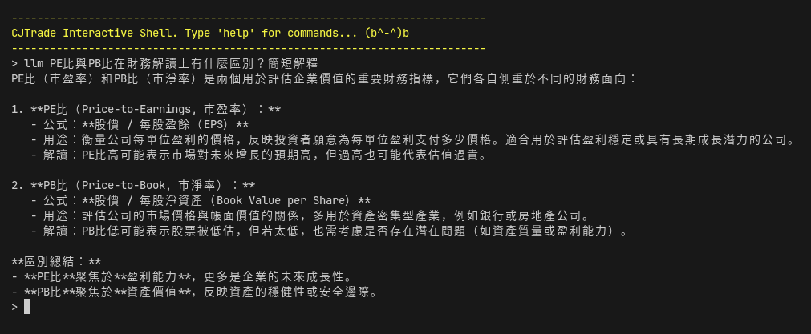
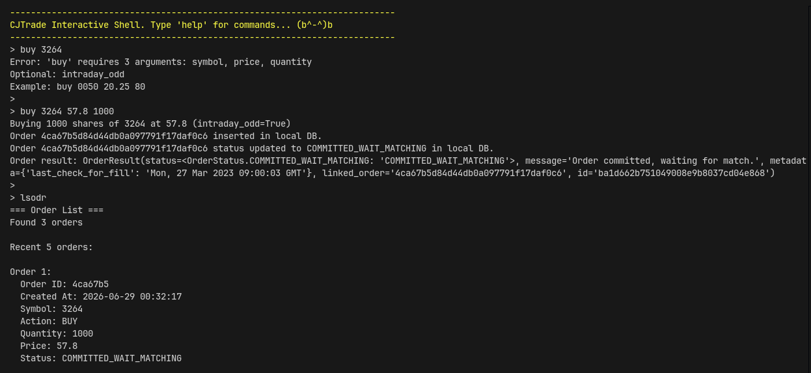

# CJTrade Shell

> An interactive shell for trading.

21 commands, which between them let you

- check your balance and positions,
- place `BUY` / `SELL` orders and cancel what is still resting,
- read quotes, five-level order books, K-bars and the day's movers,
- search recent news and TWSE announcements,
- ask an LLM for financial advice,

and more. `help` lists everything; `help <command>` shows one command's
arguments and an example.

```sh
uv run cjtrade --broker=arenax     # or --broker=sinopac
```



## Packages used

Essentially all of the CJTrade SDK. This app was originally written to exercise
the API, which is also why `uv run atest` drives it to test the brokers: every
command is a thin wrapper over one SDK call, so a command that works is an API
that works.

## Demo

Below are some demo images:

- List positions (`lspos`)

    

- Ask an LLM (`llm`)

    

    `llm` is aware of your account state — cash balance, positions, trade
    history — so you can ask about what you actually hold rather than
    describing it first.

- Place an order (`buy`), list orders (`lsodr`)

    
