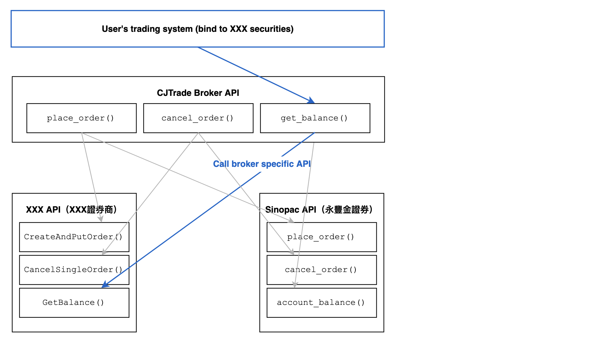
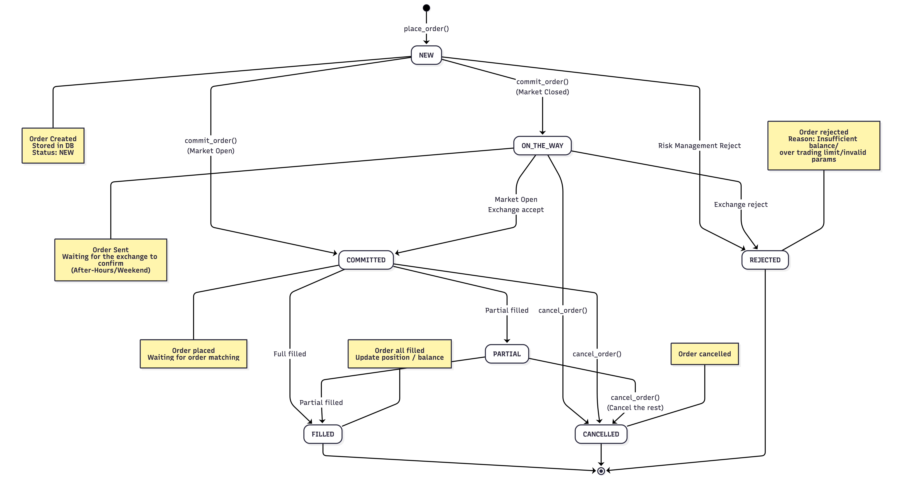

# Broker Implementation Guide

## Overview



The `cjtrade` project provides one programming interface for designing trading
strategies that work across different securities brokers (證券商). This
abstraction layer (抽象層) sits between the CJTrade API and each broker's own
backend, so an app written once — a strategy, a balance alert, a monitoring
dashboard — can be pointed at another broker without being rewritten.

## Supported Brokers

### Currently available
- **Sinopac** (永豐金證券) — full implementation with real-time data and trading
- **ArenaX** (模擬環境) — the built-in simulator: paper trading (模擬交易) and
  backtesting (回測)

### Coming soon
- **Cathay** (國泰證券) — directory exists, methods not implemented
- **Yuanta** (元大證券) — directory exists, methods not implemented
- **Mega** (兆豐證券)
- **Interactive Brokers** (盈透證券)

## Architecture

### Core abstraction

Each broker lives in its own directory under `src/cjtrade/pkgs/brokers/` and is
self-contained. They all inherit from `BrokerAPIBase`, which declares what a
broker must be able to do:

- **Connection**: connect, disconnect, report whether it is still up
- **Account**: balance, positions
- **Market data**: snapshots, five-level order book, historical K-bars
- **Orders**: place, cancel, list, and reconcile state with the broker
- **Callbacks**: price and order-status pushes, where the broker supports them
- **Session facts**: whether the market is open, and what time the broker thinks
  it is

### Interface contract

`base_broker_api.py` defines the contract every implementation must satisfy:

```python
class BrokerAPIBase(ABC):
    def connect(self) -> bool
    def disconnect(self) -> None
    def is_connected(self) -> bool
    def get_balance(self) -> float
    def get_positions(self) -> List[Position]
    def get_bid_ask(self, product: Product, intraday_odd: bool = False) -> BidAsk
    def get_snapshots(self, products: List[Product]) -> List[Snapshot]
    def get_kbars(self, products: List[Product], start: str, end: str,
                  interval: str) -> List[Kbar]
    def place_order(self, order: Order) -> OrderResult
    def cancel_order(self, order_id: str) -> OrderResult
    def list_orders(self) -> List[Trade]
    def sync_state(self) -> List[OrderResult]
    def is_market_open(self) -> bool
    # ... and more
```

Return a CJTrade model, never the broker's own object. That is the whole
promise the abstraction makes, and it is the one thing a new implementation
tends to get wrong.

## Contributing a new broker

### Prerequisites

- Understanding of OOP (物件導向程式設計)
- Access to the broker's API documentation
- API credentials for testing (sandbox / demo accounts preferred)

### Step 1: Create the directory

```bash
cd src/cjtrade/pkgs/brokers/
mkdir your_broker_name
cd your_broker_name
```

Create the following files:
```bash
touch your_broker_api.py   # the implementation
touch _internal_func.py    # data conversion and other helpers (if needed)
```

### Step 2: Implement the interface

```python
# your_broker_api.py
class YourBroker(BrokerAPIBase):
    def __init__(self, **config: Any):
        super().__init__(**config)
        self.api_key = config.get('api_key')

    def connect(self) -> bool:
        # the real logic that opens a session with YourBroker
        ...

    def get_balance(self) -> float:
        # the real logic that reads the account balance
        ...

    def place_order(self, order: Order) -> OrderResult:
        ...

    # implement the rest of the contract...
```

### Step 3: Handle data conversion

Most broker APIs answer in their own shapes. Convert those into the standard
models in `pkgs/models/` before they leave your class, so nothing above this
layer has to know which broker it is talking to.

```python
def _convert_to_position(self, broker_position_data) -> Position:
    """Convert broker-specific position data to our Position model"""
    return Position(
        symbol=broker_position_data['symbol'],
        quantity=broker_position_data['qty'],
        avg_price=broker_position_data['avg_cost'],
        # ... map other fields
    )
```

`sinopac/` is the reference. Note how everything that is conversion rather than
core logic has been moved out of `sinopac_broker_api.py` into
`_internal_func.py` — worth copying, because conversion code grows faster than
you expect.

### Step 4: Register with `AccountClient`

**Why this step matters:** `AccountClient` is the single entry point users go
through. Rather than importing and constructing a broker class themselves, they
name a broker type and `AccountClient` builds and configures it. Skip this step
and your broker works but nobody can reach it the normal way.

`AccountClient` is a factory that gives you:

1. **One interface** for every broker operation
2. **Type-safe dispatch**, via the `BrokerType` enum
3. **Lazy loading** — only the broker you asked for is imported, so a missing
   SDK for a broker you are not using cannot break the import
4. **Consistent configuration** handling

Both the enum and the dispatch live in
`src/cjtrade/pkgs/brokers/account_client.py`.

1. **Add your broker to the enum:**

```python
class BrokerType(Enum):
    SINOPAC = "sinopac"  # 永豐金
    YUANTA  = "yuanta"   # 元大
    CATHAY  = "cathay"   # 國泰
    MOCK    = "mock"     # 模擬券商 (舊，保留給既有程式)
    ARENAX  = "arenax"   # 模擬券商 (新)
    YOUR_BROKER = "your_broker"   # add this line
```

2. **Add a branch to the dispatch:**

```python
def _set_broker_api(self, broker_type: BrokerType, **config) -> BrokerAPIBase:
    if broker_type == BrokerType.SINOPAC:
        from cjtrade.pkgs.brokers.sinopac.sinopac_broker_api import SinopacBrokerAPI
        return SinopacBrokerAPI(**config)
    elif broker_type == BrokerType.ARENAX:
        from cjtrade.pkgs.brokers.arenax.arenax_broker_api import ArenaXBrokerAPI_v2
        return ArenaXBrokerAPI_v2(**config)
    elif broker_type == BrokerType.YOUR_BROKER:
        from cjtrade.pkgs.brokers.your_broker.your_broker_api import YourBroker
        return YourBroker(**config)
    else:
        raise ValueError(f"Unsupported broker type: {broker_type}")
```

The import goes **inside** the branch, not at the top of the file. That is what
keeps step 3 of the list above true.

### Step 5: Know the order state machine

Bridging the CJTrade API to a well-documented broker is straightforward work
for an experienced developer. The part that is not straightforward, and the part
worth reading before you write any code, is how an order moves between states —
placed, committed and waiting to match, partially filled, filled, cancelled,
rejected. Every broker names these differently and some collapse two of them
into one, and the mapping you choose here is what everything above you will
believe.

> Order state transition graph


## Best practices

Read an existing implementation first: `sinopac/` for a real broker, `arenax/`
for one that answers over HTTP. Between them they cover nearly every awkward
case you will hit.

## Maintenance

### Version compatibility

Keep your implementation working against:
- the broker's own API changes
- changes to the CJTrade models and `BrokerAPIBase`
- the project's supported Python version (3.12+)

Unit tests live in `tests/unit/pkgs/brokers/`, and
`tests/run_broker_stability_tests.sh --broker=<name>` exercises the hot paths
with normal input, edge cases and a stress pass.
